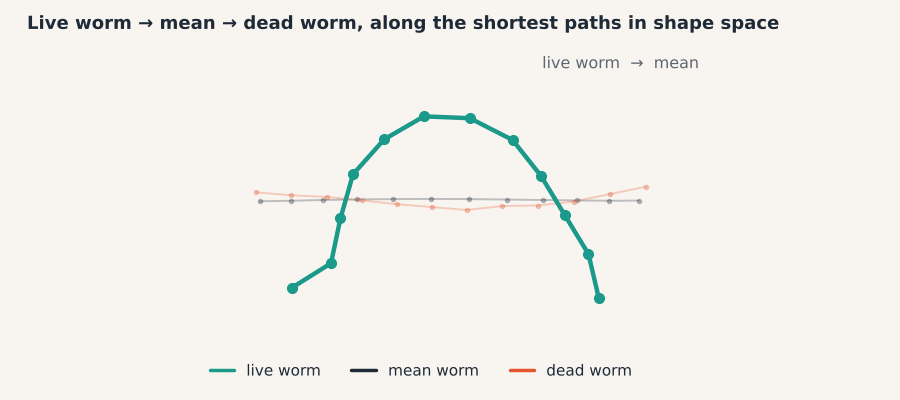

# 00 · Start here

> **In one breath.** Shape is what is left of an outline once you forget where it was, how big it was and which way it pointed. This guide turns that sentence into arithmetic you can run on 1,377 worm outlines and 1,200 cell outlines, and shows how to read what the arithmetic says back. Every formula comes with a plain-language legend and the name of the `shapekit` function that implements it.


*A live worm (teal) travels along the shortest path in shape space to the mean worm (ink) and on to a dead worm (coral). By Chapter 04 you will know what "shortest path" means here.*

## What "shape" means

Pick two worms in a brightfield image. One lies near the top-left corner, the other near the middle. One is a little larger. One points north-east, the other south. If you could slide, enlarge and turn the first until it sat exactly on top of the second, you would say they have the same shape. If no amount of sliding, enlarging and turning makes them coincide, whatever is left over is a difference in shape.

That is the definition used throughout: **shape is a configuration of points with position, size and rotation removed.** Each of the three is removed by one explicit step, and each step discards a known number of degrees of freedom.

| Removed | How | Chapter | Numbers lost (2-D) |
|---|---|---|---|
| Position | subtract the centroid | 02 | 2 |
| Size | divide by the Frobenius norm | 02 | 1 |
| Rotation | find the best angle and undo it | 03 | 1 |

Reflection is *not* removed. A worm curled to the left and its mirror image count as different shapes. [Inference] This matches the original tutorial, whose code never flips a shape; it is a choice, not a law, and a mirror step could be added.

A quick check you can do by hand. Take a triangle with corners $(0,0)$, $(4,0)$ and $(0,3)$. Move it by $(10,10)$ and double it: $(10,10)$, $(18,10)$, $(10,16)$. Chapter 02 shows that both triangles produce the same 3-by-2 table of numbers after centering and scaling, so they are the same shape. Rotate the second one by 90° and Chapter 03 still finds them identical, with the angle recovered exactly.

Once the three nuisances are gone, a shape becomes a *point* in a space of shapes. Points can be averaged (Chapter 05), measured against each other (Chapter 04) and spread out along axes of variation (Chapter 06). That is the whole program.

## Why biologists care

A great deal of phenotype is shape. Whether a worm is alive shows in how it bends; whether a fibroblast has lost lamin A/C may show in its outline. The usual way to quantify such things is a handful of hand-picked descriptors (length, area, circularity). They are easy, but they answer only the questions you thought to ask. Shape statistics asks the data which differences are large.

The worm dataset gives a concrete example of why that matters. The average dead worm and the average live worm are nearly the same, almost straight, and both lie close to the overall mean (geodesic distances 0.028 and 0.023, re-computed from the dataset). What separates the classes is the *spread*: live worms bend roughly 8 to 10 times more than dead ones [Inference from the tutorial's plot scales]. A descriptor-based pipeline that compared mean shapes would have missed the story. Chapter 06 shows how to see it.

## The two datasets

**C. elegans, from the Broad BBBC010 collection.** Brightfield images (520 × 696 pixels, 16-bit) of worms in a live/dead assay. The tutorial reduced each worm to **12 landmarks** spaced evenly along its midline from one end to the other. There are **1,377 worms: 579 dead (label 0) and 798 live (label 1)**. Before scaling, the average size was 129 pixel units for dead worms and 110 for live ones (re-computed). `shapekit.datasets.load_celegans()` returns `points` of shape `(1377, 12, 2)` and `labels` of shape `(1377,)`. Throughout the figures, dead is coral and live is teal.

**MEF cells, wild-type versus LMNA−/−.** Fluorescence images (1024 × 1280 pixels) of mouse embryonic fibroblasts, some lacking the nuclear lamina protein lamin A/C. Each cell is represented by **120 points picked at random from its outline**, so the points are *unordered*: there is no "landmark 3" on a cell. The tutorial's full set held 5,377 cells from 200 images; this repository ships a 1,200-cell subset. `shapekit.datasets.load_mef_subset()` returns `points` of shape `(1200, 120, 2)`, `labels` (0 wild-type, 1 LMNA−/−) and the original image keys. [Unverified] How the subset was drawn is recorded in `ATTRIBUTION.md`, not here. Wild-type is coral, LMNA−/− is teal.

The worms carry Chapters 02 to 07. The cells appear in Chapter 01 (outlines and the correspondence problem) and carry Chapter 08, where the lack of landmarks forces a different approach.

## Notation used everywhere

A shape with $N$ points is stored as an $N \times 2$ table, points as rows, $(x, y)$ as columns. A dataset of $K$ shapes is a `(K, N, 2)` array. From Chapter 03 onward each point is also written as a single complex number:

$$
X = \begin{pmatrix} x_1 & y_1 \\ \vdots & \vdots \\ x_N & y_N \end{pmatrix}, \qquad z_k = x_k + i\,y_k, \qquad z = (z_1, \dots, z_N)
$$

- **reading it:** $X$ is one shape as a table; $x_k, y_k$ are the pixel coordinates of its $k$-th landmark; $N$ is the number of landmarks (12 for worms); $z_k$ is the same landmark as one complex number, with $i$ the imaginary unit; $z$ is the whole shape as a list of $N$ complex numbers.
- **in shapekit:** `shapekit.preshape.to_complex(X)` and `shapekit.preshape.from_complex(z)` convert back and forth; the axis convention is stated in `shapekit/__init__.py`.

Image coordinates have $y$ increasing downward, so figures invert the y-axis to keep worms looking the way they do on screen.

## Map of the guide

| Chapter | One line |
|---|---|
| [01 From pixels to outlines](01-from-pixels-to-outlines.md) | Mask → contour or midline → evenly spaced points; landmarks, point clouds and curves; why correspondence is the hard part |
| [02 Preshape](02-preshape.md) | Subtract the centroid, divide by the norm; every shape now lives on a sphere |
| [03 Rotation, solved in one line](03-rotation-and-complex-numbers.md) | Complex numbers turn "find the best rotation" into one multiplication and one `angle()` |
| [04 Kendall shape space](04-kendall-shape-space.md) | Three distances between shapes, why two of them are the same, and the shortest path between two shapes |
| [05 Mean shapes](05-mean-shapes.md) | The Fréchet mean as an eigenvector; why the plain average is shorter; why GPA lands in the same place |
| [06 Tangent space and PCA](06-tangent-space-and-pca.md) | Flatten the sphere at the mean, run PCA, read the modes; dead versus live; sampling new worms |
| [07 Shapes as smooth curves](07-splines.md) | Cubic B-splines, exact interpolation, and the same geometry with a Gram matrix |
| [08 Learned embeddings](08-learned-embeddings.md) | PointNet and contrastive loss for outlines without landmarks |
| [09 Field notes](09-field-notes.md) | Bugs in the original tutorial and the habits that avoid them |
| [Glossary](glossary.md) · [Cheat sheet](cheatsheet.md) · [References](references.md) | Every term, every formula, every source |

Read 00 to 06 in order; each builds on the one before. Chapters 07 and 08 are independent of each other and can be read in either order after 06. Chapter 09 can be read at any time.

## How to run things

```bash
git clone <this repository> && cd shape-analysis-field-guide
pip install -e .                      # installs shapekit; numpy, scipy, matplotlib, scikit-learn
python scripts/make_figures.py        # regenerates docs/figures/ deterministically (seed 0)
python scripts/export_site_data.py    # writes docs/data/*.json for the interactive demos
cd docs && python -m http.server      # then open http://localhost:8000/index.html
# or read it online: https://daniel-waiger.github.io/shape-analysis-field-guide/
pytest                                # fast test suite; torch tests are skipped if torch is absent
```

The chapters are plain Markdown and render on GitHub as they are. The site at `docs/index.html` shows the same text but swaps each static figure for a live demo where one exists. Chapter 08 needs `torch`; everything else runs on the base dependencies.

## Why it matters in the lab

Most image-analysis pipelines end at a table of per-object descriptors. Shape statistics gives you something a table cannot: a *geometry* in which objects are points, averages are honest, distances mean something, and "the main way these objects differ" is a quantity you can compute, plot and sweep through with a slider. Knowing the few formulas behind that geometry is what lets you adapt it to a new organism, a new marker or a new question, rather than waiting for a tool to exist.

## Try it

```python
from shapekit.datasets import load_celegans, load_mef_subset
import matplotlib.pyplot as plt

points, labels = load_celegans()
print(points.shape, labels.shape)                   # (1377, 12, 2) (1377,)
print((labels == 0).sum(), (labels == 1).sum())     # 579 dead, 798 live

cells, cell_labels, keys = load_mef_subset()
print(cells.shape, cell_labels.shape)               # (1200, 120, 2) (1200,)

w = points[0]
plt.plot(w[:, 0], w[:, 1], "o-")
plt.gca().invert_yaxis(); plt.axis("equal"); plt.show()
```

## Check yourself

<details><summary>1. Two worms differ only in that one is twice as large and rotated by 30°. Same shape or different?</summary>

Same shape. Size and rotation are both removed by definition. Only what remains after sliding, scaling and turning counts.
</details>

<details><summary>2. Why can you not simply average the 12 landmarks of all worms as they come out of the images?</summary>

Because the raw coordinates still contain position, size and rotation. Averaging them mixes "where the worm was" with "how the worm was shaped" and the result is dominated by the nuisances, not the shape. Chapters 02, 03 and 05 remove them first.
</details>

<details><summary>3. What is missing from the MEF cell representation that the worms have?</summary>

Correspondence. Each worm's landmark $k$ is at the same relative position along the body for every worm. The 120 cell points are random samples from the outline, so point $k$ of one cell has nothing to do with point $k$ of another. Chapter 01 explains the consequence, Chapter 08 the workaround.
</details>

## Credits

This guide adapts *Shape Analysis 101* by Johannes Hugger and Virginie Uhlmann (Uhlmann group, EMBL-EBI, 2021; BSD-3), whose course structure, datasets and worked results it follows. The worm landmarks derive from BBBC010 (Ljosa, Sokolnicki & Carpenter 2012); the cell outlines from the Micropattern_MEF_LMNA_Image dataset (kukionfr), both as prepared by the tutorial. The text, figures, demos and code in this repository are new; nothing from the tutorial is reproduced verbatim except the two data files and bibliographic citations. Full list: [ATTRIBUTION.md](../../ATTRIBUTION.md).

**Next:** [01 · From pixels to outlines](01-from-pixels-to-outlines.md)
