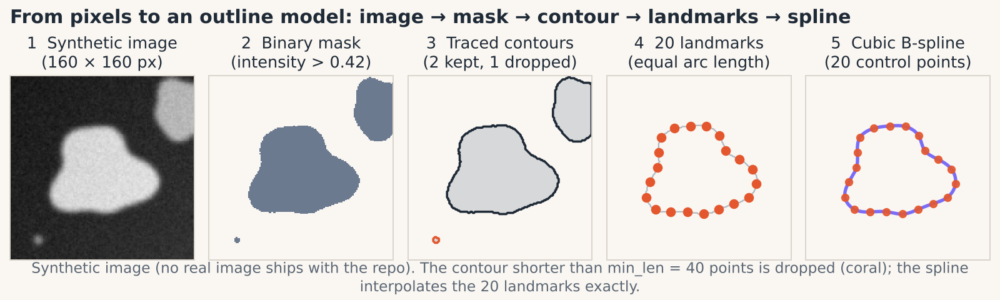
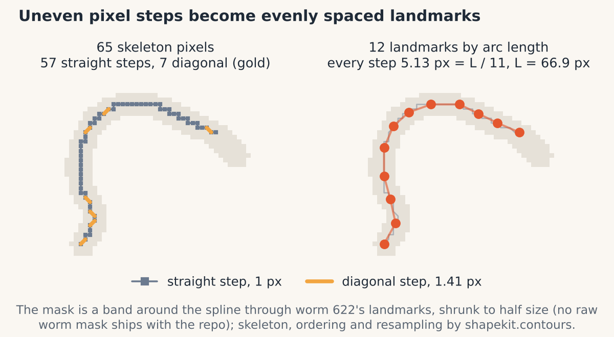
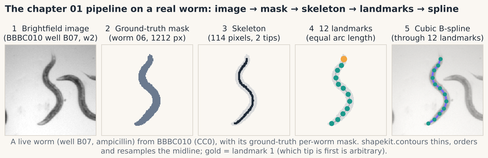
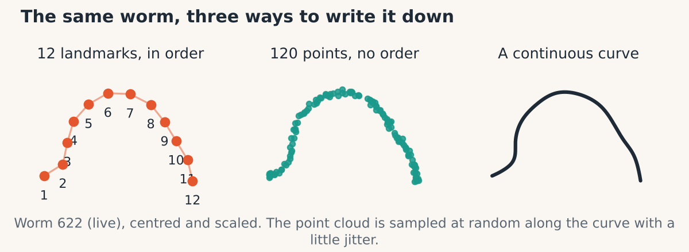

# 01 · From pixels to outlines

> **In one breath.** A segmentation mask is a picture; shape analysis needs numbers. The route is mask → traced boundary (or midline) → points spaced evenly by arc length. The result can be a list of corresponding landmarks, an unordered point cloud, or a smooth curve, and which one you pick decides what every later chapter can and cannot do.


*From an image to three kinds of outline model: mask, contour, 20 evenly spaced landmarks, and a cubic spline fitted through them (Chapter 07).*

## Masks: binary versus instance

A **mask** is a second image the same size as the photograph in which each pixel says what it belongs to. A *binary* mask says only "object or not" (the tutorial's worm mask: 0 for background, 255 for the worm, 1,212 worm pixels). An *instance* mask gives every object its own integer (the MEF mask: 0 for background, 1 to 11 for eleven cells). Instance masks are the ones you want. Turning them into binary is one comparison, `mask == k`, while going the other way means re-separating touching objects, which is the hard part of segmentation all over again.

## Tracing the boundary

For a closed object like a cell, `shapekit.contours.mask_to_contours(mask, min_len)` traces the boundary. Think of the mask as a landscape where a pixel's value is its height; the contour is the shoreline at height 0.5, traced between pixel centers one 2 × 2 block at a time. [Inference] This is the marching-squares method scikit-image uses under `find_contours`; the tutorial points at the documentation rather than describing it. The output is an ordered loop of points around each object.

The `min_len` filter matters. In the tutorial's MEF mask, 17 contours were found and only 10 kept: the 7 dropped ones had between 3 and 96 points and were segmentation debris. Decide the threshold by looking at what you discard, not by guessing.

For an elongated object like a worm, the boundary is the wrong line. What varies between worms is the *bend of the body*, which is captured by the **midline**. `shapekit.contours.order_skeleton(mask)` does two things:

1. **Skeletonize.** Peel the mask away one pixel layer at a time from all sides until a one-pixel-wide center line remains (about 104 pixels for the tutorial's worm).
2. **Find an end and walk.** For each skeleton pixel, look at its 3 × 3 neighborhood with the center removed. A pixel in the middle of the line has neighbors on two sides, forming two separate groups; a tip has neighbors on one side only, one group. Start at the first tip found, then repeatedly step to the nearest unvisited pixel. This lists the pixels from one end to the other.

The tutorial's variable for the midline is called `celegans_contour`. It is not a contour. Names outlive intentions; see Chapter 09.

## Even spacing by arc length

The ordered skeleton pixels are unevenly spaced: a diagonal step is $\sqrt{2} \approx 1.414$ pixels long, a straight step is 1. If you simply took every $k$-th pixel, "landmark 5" would sit at a slightly different fraction of the body on every worm. The fix is to re-space the points by distance traveled along the curve.


*Left: skeleton pixels, where diagonal and straight steps differ in length. Right: the same curve resampled at equal arc length.*

$$
s_0 = 0, \qquad s_j = s_{j-1} + \lVert p_j - p_{j-1} \rVert, \qquad t_k = \frac{k}{N-1}\, s_{M-1}, \quad k = 0, \dots, N-1
$$

- **reading it:** $p_j$ is the $j$-th ordered pixel of the midline (there are $M$ of them); $\lVert p_j - p_{j-1} \rVert$ is the straight-line distance between consecutive pixels; $s_j$ is the cumulative distance walked to reach pixel $j$, so $s_{M-1}$ is the total length; $t_k$ are $N$ target distances spaced evenly from 0 to that total. Each landmark is the point found by walking distance $t_k$ along the polyline, interpolating linearly between the two pixels that bracket it.
- **in shapekit:** `shapekit.contours.resample_by_arclength(points, N)`.

**Worked example.** Four ordered pixels $p = (0,0), (1,0), (2,1), (3,1)$. Steps: 1, $\sqrt 2$, 1, so $s = (0,\ 1,\ 2.414,\ 3.414)$. Ask for $N = 3$ landmarks: targets $t = (0,\ 1.707,\ 3.414)$. The first and last are the ends. The middle target, 1.707, lies between $s_1 = 1$ and $s_2 = 2.414$, a fraction $(1.707-1)/1.414 = 0.5$ of the way, so the landmark is halfway between $(1,0)$ and $(2,1)$: $(1.5, 0.5)$. Index-based picking would have returned $(1,0)$ or $(2,1)$, neither of which is the body's midpoint.

The tutorial used $N = 20$ for its demonstration worm; the dataset in Chapter 02 onward uses $N = 12$. [Inference] The 12-point models in the dataset have segment lengths varying by only about 2 % within each worm, so they were made this way.

Here is the whole route on one real worm, with the numbers `shapekit` gets on it.


*One real BBBC010 worm, B07_06 (well B07, ampicillin-treated, live): brightfield image → its ground-truth per-worm mask (1,212 pixels) → skeleton (114 pixels, 2 tips) → 12 landmarks at equal arc length (gold: landmark 1, an arbitrary tip) → cubic B-spline through them. Made by `scripts/make_sample_images.py`; the synthetic figure at the top is kept for the cell case, a closed outline traced from a mask.*

This is the tutorial's demonstration worm (the same 1,212-pixel mask). `shapekit.contours.skeletonize` (Zhang–Suen thinning) leaves 114 skeleton pixels where the tutorial's skeletonization left about 104. scikit-image's `skeletonize` (version 0.26) gives exactly 104 on the same mask, so the mask is not the cause; [Inference] the difference is the thinning algorithm.

## Three representations


*One worm, three models. Landmarks are ordered and few; the point cloud is unordered and dense; the curve is continuous.*

| Representation | What it is | Order matters? | Used in |
|---|---|---|---|
| **Landmarks** | $N$ points, each at a defined place on the body | Yes | Chapters 02–06 |
| **Point cloud** | many points sampled from the outline, no order | No | Chapter 08 |
| **Curve** | a continuous function $t \mapsto (x(t), y(t))$ through the landmarks | Yes | Chapter 07 |

The three are not interchangeable, and the reason is correspondence.

## The correspondence problem

Everything from Chapter 02 to Chapter 07 compares landmark $k$ of one shape with landmark $k$ of another. That comparison is meaningful only if landmark $k$ means "the same place" on every object. Arc-length spacing along an ordered midline gives that for worms: landmark 6 of 12 is always just under halfway along the body. Random points on a cell outline give nothing of the kind: point 6 of one cell is wherever the random generator put it. Averaging two point clouds point by point is noise.

Two consequences follow.

First, for worms, head and tail are not distinguished. The skeleton walk starts at whichever tip is found first, so some worms are listed one way and some the other. [Inference] For a nearly straight worm, reversing the order is almost the same as a 180° rotation, which Chapter 03 removes. For a bent worm it is instead a reflection of the landmark labeling, which is not removed, so the *sign* of a bend ("curls left" versus "curls right") is partly an artifact of which end was found first. The original tutorial does not discuss this; keep it in mind when reading the modes of variation in Chapter 06.

Second, for cells, there is no cheap fix. One could order the contour and resample it, but a closed loop has no natural starting point and no natural direction, and cells are not elongated enough to define one reliably. Chapter 08 takes the other road: a model that is *indifferent* to point order by construction.

## Why it matters in the lab

Almost every failure of a shape-analysis project starts here, not in the statistics. A contour threshold that keeps debris, a skeleton that branches at a lump of dirt, an index-based resampling that drifts with pixel length, or an ordering that flips head and tail will all pass silently through the elegant mathematics of the later chapters and come out the other end as a confident wrong answer. Spend the time on this step. Plot the ordered points with their indices on a dozen objects before trusting the pipeline on a thousand.

## Try it

```python
import numpy as np
from shapekit.contours import mask_to_contours, order_skeleton, resample_by_arclength

# A synthetic bent worm mask: thicken a sine curve
yy, xx = np.mgrid[0:120, 0:200]
mid = 60 + 25 * np.sin(xx / 30.0)
mask = (np.abs(yy - mid) < 6) & (xx > 20) & (xx < 180)

skeleton_pts = order_skeleton(mask)                 # ordered (M, 2) midline, one end to the other
landmarks = resample_by_arclength(skeleton_pts, 12)  # (12, 2), evenly spaced by arc length
steps = np.linalg.norm(np.diff(landmarks, axis=0), axis=1)
print(steps.round(2))                                # all nearly equal

contours = mask_to_contours(mask, min_len=50)        # the boundary, for comparison
print(len(contours), contours[0].shape)
```

## Check yourself

<details><summary>1. Why resample by arc length instead of taking every k-th skeleton pixel?</summary>

Because pixel steps have unequal lengths (1 versus $\sqrt 2$), so equal index spacing is unequal distance spacing, and landmark $k$ would land at a different fraction of the body on each worm. Arc-length spacing puts landmark $k$ at the same fraction every time, which is what correspondence requires.
</details>

<details><summary>2. A cell's outline has been traced as an ordered loop of 300 points. Can you resample it to 12 landmarks and feed it to Chapters 02–06?</summary>

You can run the code, but the landmarks will not correspond across cells: a closed loop has no canonical start point or direction, so landmark 1 of one cell is at an arbitrary place relative to landmark 1 of another. The statistics would be measuring the arbitrary start, not the shape.
</details>

<details><summary>3. In the worked example, why is the middle landmark at (1.5, 0.5) and not at pixel (2, 1)?</summary>

The total arc length is 3.414, so the midpoint is at distance 1.707. Pixel $(2,1)$ sits at distance 2.414, past the midpoint. The midpoint lies halfway along the diagonal step from $(1,0)$ to $(2,1)$.
</details>

## Credits

Adapted from notebook 1 (*Data Preparation*) of *Shape Analysis 101* by Johannes Hugger and Virginie Uhlmann (Uhlmann group, EMBL-EBI, 2021; BSD-3): the mask → contour → skeleton → arc-length → spline pipeline and the *C. elegans* / MEF examples are theirs; the explanations, figures and `shapekit.contours` are new. Contour tracing follows scikit-image's `find_contours`; thinning is the Zhang–Suen algorithm (1984). The real worm in the pipeline figure is from the Broad Bioimage Benchmark Collection set BBBC010 (<https://bbbc.broadinstitute.org/BBBC010>; Ljosa, Sokolnicki & Carpenter 2012, *Nature Methods* 9:637; images by Fred Ausubel), released under CC0; image `1649_1109_0003_Amp5-1_B_20070424_B07_w2_*.tif` and per-worm ground-truth mask `B07_06_ground_truth.png` (<https://creativecommons.org/publicdomain/zero/1.0/>; full credit in `docs/lab/data/images/celegans/CREDIT.md`).

**Next:** [02 · Preshape: removing position and size](02-preshape.md)
