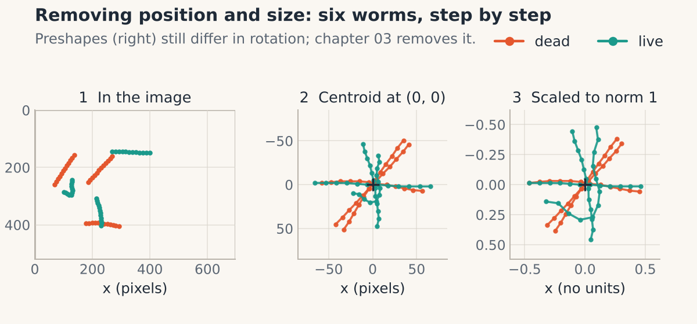
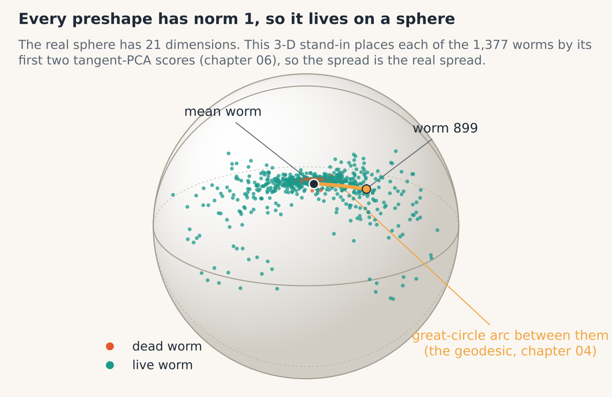

# 02 · Preshape: removing position and size

> **In one breath.** Subtract the centroid and the shape forgets where it was. Divide by the Frobenius norm and it forgets how big it was. What remains, the *preshape*, is a point on the surface of a sphere, and every centered, unit-size shape in the world lives on that same sphere. Rotation is still in there; Chapter 03 deals with it.


*Left: worms where the camera found them. Middle: each moved so its centroid sits at (0, 0). Right: each also scaled to size 1 and overlaid. Rotation differences remain.*

<div class="demo" data-demo="preshape"></div>

## Step one: centering

A shape with $N$ landmarks is an $N \times 2$ table $X$. Its **centroid** is the average row, the point you would get by balancing the 12 landmarks on a pin. Subtracting the centroid from every row moves that balance point to the origin.

$$
\bar{x} = \frac{1}{N}\sum_{k=1}^{N} x_k, \qquad \bar{y} = \frac{1}{N}\sum_{k=1}^{N} y_k, \qquad X_c = X - (\bar{x}, \bar{y})
$$

- **reading it:** $x_k, y_k$ are the coordinates of landmark $k$; $\bar x, \bar y$ are their averages, the centroid; $X_c$ is the centered shape, obtained by subtracting the centroid from every landmark. After this step the centered coordinates sum to zero in both $x$ and $y$.
- **in shapekit:** `shapekit.preshape.center(X)`. It accepts one shape `(N, 2)` or a whole dataset `(K, N, 2)` and averages over the *points* axis. Averaging over the wrong axis is the single most damaging bug in the original tutorial; Chapter 09 dissects it.

Two numbers of information are gone: the $x$ and $y$ of where the worm was in the image. Nothing about its form has changed.

## Step two: scaling

How big is a shape? Not its length (a bent worm is "shorter" end to end than a straight one of the same body length) and not its area (a 12-point polyline has none). The measure used throughout is the **Frobenius norm** of the centered table: the square root of the sum of all squared coordinates, which is the root-sum-square of the landmarks' distances from the centroid. [Unverified] In the shape-statistics literature this is called *centroid size*.

$$
\lVert X_c \rVert = \sqrt{\sum_{k=1}^{N} \left( x_k^2 + y_k^2 \right)}, \qquad Z = \frac{X_c}{\lVert X_c \rVert}
$$

- **reading it:** $x_k, y_k$ are now the *centered* coordinates; $x_k^2 + y_k^2$ is the squared distance of landmark $k$ from the centroid; the sum runs over all $N$ landmarks; the square root makes the result a length in pixels; $Z$ is the preshape, the centered shape divided by its size so that $\lVert Z \rVert = 1$.
- **in shapekit:** `shapekit.preshape.normalize(X)` divides by this norm; `shapekit.preshape.preshape(X)` does both steps, `normalize(center(X))`.

Dividing every coordinate by the same number keeps all the proportions and throws away exactly one number: the size. In the C. elegans dataset that number was, on average, 129 for dead worms and 110 for live ones (re-computed from the dataset). Those are pixel units, and they are a real phenotype. The point is not that size is uninteresting; it is that size is not *shape*, and mixing them would let a 20 % size difference swamp a 2 % bend. Save the norm in a column before you divide if you will want it later.

## Worked example

Triangle $A$ with corners $(0,0)$, $(4,0)$, $(0,3)$.

Centroid: $\bar x = (0+4+0)/3 = 4/3$, $\bar y = (0+0+3)/3 = 1$.

Centered rows: $(-\tfrac43, -1)$, $(\tfrac83, -1)$, $(-\tfrac43, 2)$. Check: the $x$ values sum to $-\tfrac43 + \tfrac83 - \tfrac43 = 0$, the $y$ values to $-1 - 1 + 2 = 0$.

Norm: $\sqrt{\tfrac{16}{9} + 1 + \tfrac{64}{9} + 1 + \tfrac{16}{9} + 4} = \sqrt{\tfrac{96}{9} + 6} = \sqrt{16.667} = 4.082$.

Preshape: $(-0.327, -0.245)$, $(0.653, -0.245)$, $(-0.327, 0.490)$. The squares of those six numbers sum to 1.

Now triangle $B$: the same corners shifted by $(10, 10)$ and doubled, $(10,10)$, $(18,10)$, $(10,16)$. Centroid $(12.667, 12)$. Centered rows: $(-\tfrac83, -2)$, $(\tfrac{16}{3}, -2)$, $(-\tfrac83, 4)$, exactly twice $A$'s. Norm $8.165$, exactly twice. Preshape: identical to $A$'s, digit for digit. Position and size have been removed; what was never different was never touched.

## Where preshapes live: the sphere


*Every preshape has norm 1, so it sits on the surface of a sphere. The picture is 3-D; the real one has 21 dimensions. The arc is the subject of Chapter 04.*

A preshape is $2N$ numbers (24 for a worm) with three constraints: the $x$ values sum to zero, the $y$ values sum to zero, and the squared coordinates sum to one. The first two constraints confine the shape to a flat subspace of $2N - 2$ dimensions; the third confines it to the unit sphere inside that subspace, a surface of dimension $2N - 3$. For $N = 12$ that is a 21-dimensional sphere, written $S^{21}$. You cannot picture it, but you do not need to. Everything that is true of a globe is true of it: every point is at distance 1 from the center, the shortest route between two points is an arc of a great circle, and a plain average of points on the surface falls inside, not on it (Chapter 05).

This is why the geometry of the later chapters is the geometry of spheres and not of flat space. Nothing exotic was chosen; it is simply what "norm equals one" means.

Note what the sphere does *not* yet account for. Rotating a preshape by any angle gives another preshape, another point on the same sphere, and the two are the same shape. So each shape is not one point on $S^{21}$ but a whole circle of them. Collapsing those circles is Chapter 03's job, and the collapsed space is Kendall's shape space, Chapter 04.

## Why it matters in the lab

Preshape is the step that makes shapes from different wells, different magnifications and different days comparable at all. Done once, correctly, it also tells you what you have decided *not* to study. If your biology is in the size (cell spreading area, worm length after starvation), keep the norm as its own measurement; if it is in the proportions, you have just cleaned it of two confounds. The step is three lines of code, which is exactly why its axis bug went unnoticed in the original tutorial: nobody looked at the output of something so simple.

## Try it

```python
import numpy as np
from shapekit.datasets import load_celegans
from shapekit.preshape import center, normalize, preshape

points, labels = load_celegans()
centered = center(points)                       # (1377, 12, 2); each worm's centroid at (0, 0)
sizes = np.linalg.norm(centered.reshape(len(points), -1), axis=1)
print(sizes[labels == 0].mean(), sizes[labels == 1].mean())   # ~129 (dead), ~110 (live)

Z = preshape(points)                            # same as normalize(center(points))
print(np.abs(Z.sum(axis=1)).max())              # ~0: centroids are at the origin
print(np.linalg.norm(Z.reshape(len(Z), -1), axis=1)[:3])      # 1, 1, 1

A = np.array([[0., 0.], [4., 0.], [0., 3.]])
B = 2 * A + 10
print(np.allclose(preshape(A), preshape(B)))    # True
```

## Check yourself

<details><summary>1. After centering, what do the x-coordinates of the landmarks add up to?</summary>

Zero, and so do the $y$-coordinates. That is what "the centroid is at the origin" means, and it is the quickest sanity check on a `center` implementation.
</details>

<details><summary>2. Why divide by the Frobenius norm rather than by, say, the distance from head to tail?</summary>

Head-to-tail distance depends on how bent the worm is, so dividing by it would change the shape, not just the size. The Frobenius norm treats all landmarks symmetrically and is the measure under which "scaling by a factor $c$" multiplies the size by exactly $c$ and nothing else. It also makes the preshapes lie on a sphere, which the rest of the guide relies on.
</details>

<details><summary>3. How many real numbers does it take to describe a worm preshape, and why is that not 24?</summary>

22 coordinates, but only 21 of them are free. Starting from 24 coordinates, centering fixes two sums to zero (24 → 22 coordinates) and scaling fixes the norm to one, which removes one more degree of freedom (a 21-dimensional surface). Rotation will remove one more in Chapter 03, leaving 20, which is the number of nonzero PCA components found in Chapter 06.
</details>

**Next:** [03 · Rotation, solved in one line](03-rotation-and-complex-numbers.md)
