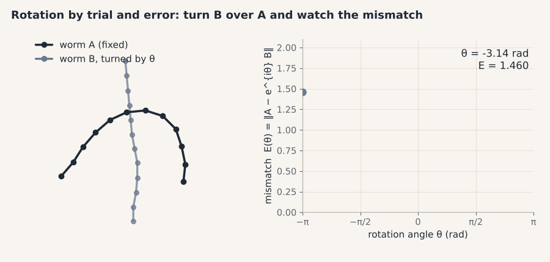
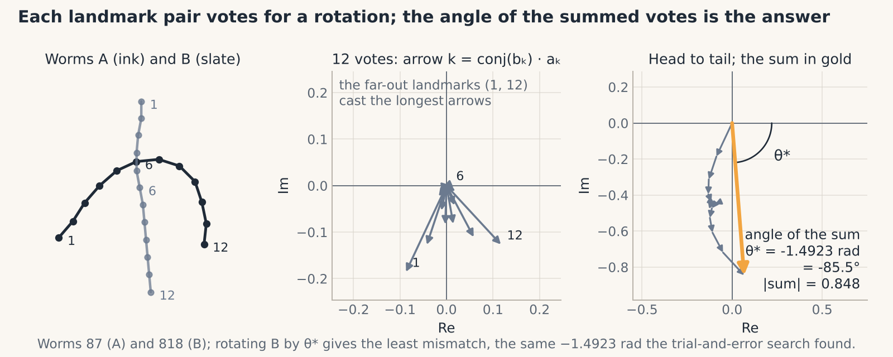

# 03 · Rotation, solved in one line

> **In one breath.** The best rotation of one preshape onto another can be found by trial and error, turning the shape until the mismatch stops shrinking. Or you can write each landmark as a complex number, in which case the answer is the angle of a single sum: $\theta^\ast = \operatorname{angle}\big(\sum_k \bar z_k w_k\big)$. Both give the same number to nine digits; the second takes one line and never gets stuck.

## Rotation the slow way

After Chapter 02, two worms are centered and unit-sized but may still point in different directions. The natural fix is to turn one of them until it matches the other as well as possible. Turning a point $(x, y)$ by an angle $\theta$ about the origin is a matrix multiplication:

$$
R(\theta) = \begin{pmatrix} \cos\theta & -\sin\theta \\ \sin\theta & \cos\theta \end{pmatrix}, \qquad E(\theta) = \big\lVert A - B\,R(\theta)^{\mathsf T} \big\rVert
$$

- **reading it:** $R(\theta)$ is the 2 × 2 rotation matrix for angle $\theta$ (radians, counter-clockwise); $A$ and $B$ are two preshapes as $N \times 2$ tables; $B\,R^{\mathsf T}$ is $B$ with every landmark rotated; $E(\theta)$ is the Frobenius norm of the landmark-by-landmark difference, the mismatch we want small.
- **in shapekit:** this version exists only for teaching; the closed form below is what `shapekit.procrustes` implements.

Hand a numerical optimizer the function $E$ and a starting guess of $\theta = 0$, and it will walk downhill until the mismatch stops shrinking. The original tutorial does this with `scipy.optimize.minimize` on one pair of worms and finds $\theta = -1.4923$ rad, about $-85.5^\circ$. (It calls $E$ an RMSE; it is really the plain norm, but dividing by a constant does not move the minimum, so the answer is unaffected.)


*Worm B (slate) rotating over worm A (ink) while the mismatch $E(\theta)$ is traced out. The optimizer stops at the marked minimum, θ = −1.4923 rad for this C. elegans pair.*

<div class="demo" data-demo="rotate-align"></div>

It works. It is also slow for 1,377 worms, it needs a starting guess, and in principle a search can stall in a dip that is not the lowest one. All of that disappears if we change notation.

## A point is a complex number

A complex number $z = x + i\,y$ is just a pair of real numbers with one extra rule: $i \cdot i = -1$. Draw it as the point $(x, y)$. Under that reading, the rule means something geometric. Multiply $z = 1$, the point $(1, 0)$, by $i$: you get $i$, the point $(0, 1)$. Multiply again: $i \cdot i = -1$, the point $(-1, 0)$. Again: $-i$, the point $(0, -1)$. Each multiplication by $i$ turns the point by 90° counter-clockwise.

A general angle uses **Euler's formula** and the same trick:

$$
e^{i\theta} = \cos\theta + i\sin\theta, \qquad (x + iy)\,e^{i\theta} = (x\cos\theta - y\sin\theta) + i\,(x\sin\theta + y\cos\theta)
$$

- **reading it:** $e^{i\theta}$ is the point on the unit circle at angle $\theta$; multiplying any complex number by it turns that number by $\theta$ about the origin. Expand the product and the real part is the first row of $R(\theta)$ applied to $(x, y)$, the imaginary part the second row. One complex multiplication is the whole rotation matrix.
- **in shapekit:** `shapekit.preshape.to_complex(X)` turns an `(N, 2)` shape into `(N,)` complex numbers, `from_complex` turns it back.

So a worm becomes a list of 12 complex numbers $z = (z_1, \dots, z_{12})$, and "rotate the worm by $\theta$" becomes `np.exp(1j * theta) * z`. The preshape norm is unchanged: $\lVert z \rVert^2 = \sum_k \lvert z_k \rvert^2 = \sum_k (x_k^2 + y_k^2)$, the same number as before.

Check with the tutorial's own test: the vectors $(10, 7)$ and $(5, 5)$. As complex numbers, $\bar z\, w = (10 - 7i)(5 + 5i) = 50 + 50i - 35i - 35i^2 = 85 + 15i$, whose angle is $\arctan(15/85) = 0.17467$ rad. The ordinary two-vector angle formula gives the same 0.17467. Nothing has been lost in translation.

## The one-line answer

We want the $\theta$ that minimizes $\lVert w - e^{i\theta} z \rVert^2$, the mismatch after rotating $z$ onto $w$. Expand the square using the complex inner product $\langle z, w \rangle = \sum_k \bar z_k w_k$, where the bar is the complex conjugate ($\overline{x + iy} = x - iy$):

$$
\lVert w - e^{i\theta} z \rVert^2 = \lVert w \rVert^2 + \lVert z \rVert^2 - 2\,\mathrm{Re}\!\left(e^{-i\theta} \sum_{k=1}^{N} \bar z_k w_k\right) = 2 - 2\,\lvert c \rvert \cos(\phi - \theta), \qquad c = \sum_{k=1}^{N} \bar z_k w_k = \lvert c \rvert e^{i\phi}
$$

- **reading it:** $z$ and $w$ are the two preshapes as complex vectors, both of norm 1 (so the first two terms are 1 + 1); $\bar z_k$ is the conjugate of landmark $k$ of $z$; $c$ is the sum of all $\bar z_k w_k$, a single complex number with length $\lvert c \rvert$ and angle $\phi$; $\mathrm{Re}$ takes the real part. Only the cosine term depends on $\theta$, and it is largest, so the mismatch is smallest, when $\theta = \phi$.

$$
\theta^\ast = \operatorname{angle}\!\left(\sum_{k=1}^{N} \bar z_k\, w_k\right), \qquad z_{\text{aligned}} = e^{i\theta^\ast} z
$$

- **reading it:** $\theta^\ast$ is the best rotation angle, read off as the angle of the complex number $c$; $z_{\text{aligned}}$ is $z$ rotated by that angle, now sitting as close to $w$ as any rotation can bring it. No search, no starting guess, no local minima.
- **in shapekit:** `shapekit.procrustes.optimal_rotation_angle(z, w)` returns $\theta^\ast$ (in code, `np.angle(np.vdot(z, w))`, which conjugates its first argument); `shapekit.procrustes.align(z, w)` returns $e^{i\theta^\ast} z$; `shapekit.procrustes.align_dataset(Z, ref)` does it for every shape in a `(K, N)` array against one reference.

On the same C. elegans pair the optimizer found $-1.4923$, the formula gives $-1.4922899425$: identical to nine digits, in a microsecond.

## The votes picture


*Each landmark pair casts a vote, the arrow $\bar z_k w_k$. Their sum (gold) points at the rotation the whole worm wants.*

Each term $\bar z_k w_k$ is itself a complex number, an arrow. Its angle is the angle from landmark $k$ of $z$ to landmark $k$ of $w$: the rotation *that one landmark pair* would ask for. Its length is $\lvert z_k \rvert \lvert w_k \rvert$: landmarks far from the centroid cast long arrows, landmarks near it cast short ones. The sum $c$ adds all twelve arrows head to tail, and its angle is the consensus. Far-out landmarks (head and tail of a worm) carry more weight than central ones, which is reasonable: a central landmark barely moves under rotation and barely knows what the angle is.

**Worked example, by hand.** Two two-point shapes: $z = (1,\ -1)$, meaning landmarks at $(1,0)$ and $(-1,0)$; and $w = (i,\ -i)$, landmarks at $(0,1)$ and $(0,-1)$. Votes: $\bar 1 \cdot i = i$ and $\overline{(-1)} \cdot (-i) = i$. Both arrows point straight up; their sum is $2i$, angle $90^\circ$. Rotating $z$ by $90^\circ$: $i \cdot 1 = i$ and $i \cdot (-1) = -i$, which is $w$ exactly. Mismatch zero.

Now let the landmarks disagree: $z = (1,\ 0.5)$, $w = (i,\ 0.5)$. Votes: $\bar 1 \cdot i = i$ (asks for $90^\circ$) and $\overline{0.5} \cdot 0.5 = 0.25$ (asks for $0^\circ$). Sum: $0.25 + i$, angle $\arctan(1/0.25) = 75.96^\circ$. The first landmark is twice as far from the origin in both shapes, so its arrow is four times as long (1 versus 0.25); it wins most of the argument but not all of it. Neither landmark ends up exactly on its partner; the compromise minimizes the *total* squared mismatch, which is what we asked for.

## Why it matters in the lab

Alignment is run far more often than you might think: once per worm against a mean, once per iteration of Generalized Procrustes (Chapter 05), once per shape in every distance computation (Chapter 04), once per shape when flattening to the tangent plane (Chapter 06). A closed form that is exact, deterministic and far faster than a numerical search is the difference between an analysis that runs interactively and one that runs overnight with occasional silent failures. It is also the reason the rest of this guide is written in complex numbers: not for elegance, but because the elegance *is* the speed and the robustness.

## Try it

```python
import numpy as np
from shapekit.datasets import load_celegans
from shapekit.preshape import preshape, to_complex, from_complex
from shapekit.procrustes import optimal_rotation_angle, align

Z = to_complex(preshape(load_celegans()[0]))     # (1377, 12) complex preshapes
z, w = Z[0], Z[1]

theta = optimal_rotation_angle(z, w)              # angle(sum conj(z_k) w_k)
print(theta, np.degrees(theta))
print(np.linalg.norm(w - z), np.linalg.norm(w - align(z, w)))   # mismatch before, after

# hand examples from the text
print(np.degrees(optimal_rotation_angle(np.array([1, -1]), np.array([1j, -1j]))))     # 90.0
print(np.degrees(optimal_rotation_angle(np.array([1, 0.5]), np.array([1j, 0.5]))))    # 75.96
print(np.angle(np.vdot(np.array([10 + 7j]), np.array([5 + 5j]))))                     # 0.17467
```

## Check yourself

<details><summary>1. What does multiplying a complex number by $e^{i\theta}$ do to the point it represents, and what happens to its distance from the origin?</summary>

It rotates the point by $\theta$ counter-clockwise about the origin. The distance from the origin is unchanged, because $\lvert e^{i\theta} \rvert = 1$. That is why rotating a preshape gives another preshape.
</details>

<details><summary>2. Why is the best angle the angle of the sum of the votes and not, say, the average of the individual angles?</summary>

Because the quantity being minimized is the total squared mismatch, and expanding it shows that only $\mathrm{Re}(e^{-i\theta} c)$ depends on $\theta$, where $c$ is the sum of the votes. Averaging angles would ignore the lengths of the arrows, that is, how far each landmark is from the centroid and therefore how much it actually moves when rotated.
</details>

<details><summary>3. `optimal_rotation_angle(z, w)` returns θ. Which shape do you multiply by $e^{i\theta}$?</summary>

$z$, the first argument. The formula $\operatorname{angle}(\sum \bar z_k w_k)$ gives the angle *from* $z$ *to* $w$. Swapping the arguments negates the angle. Getting this backwards does not crash; it quietly doubles the misalignment, so check it on one pair by plotting.
</details>

## Credits

Adapted from notebook 2A (*Discrete Shape Analysis*) of *Shape Analysis 101* by Johannes Hugger and Virginie Uhlmann (Uhlmann group, EMBL-EBI, 2021; BSD-3), including its complex-number formulation of the rotation problem and the two worms used in the figures. The theory is Kendall's (1984) as set out in Dryden & Mardia (2016).

**Next:** [04 · Kendall shape space](04-kendall-shape-space.md)
