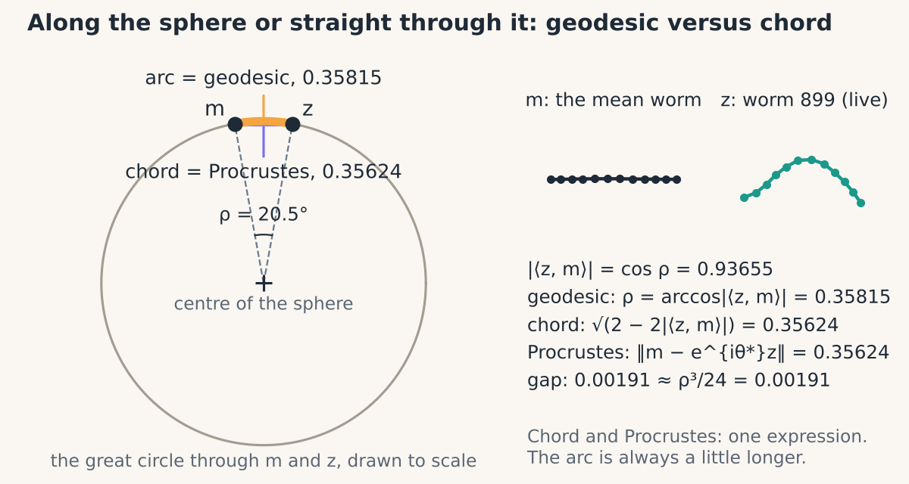
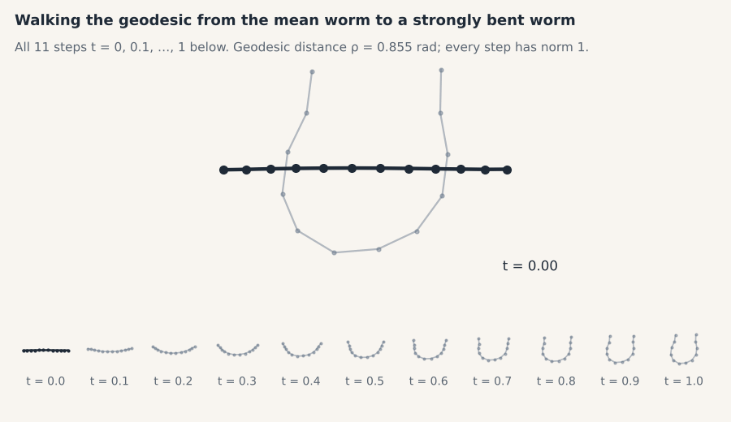

# 04 · Kendall shape space

> **In one breath.** On the preshape sphere every shape appears as a whole ring of rotated copies; treat each ring as one point and you have Kendall's shape space. Distance between two shapes can be measured along the sphere (geodesic), straight through it (chord), or as the leftover mismatch after the best rotation (Procrustes). The last two are the same number, exactly, and the first is always slightly larger. The shortest path between two shapes is a great-circle arc, and walking along it morphs one shape into the other.

## From sphere to shape space

Chapter 02 put every preshape on a sphere $S^{21}$. Chapter 03 showed that rotating a preshape by any angle gives another preshape, $e^{i\theta} z$, which is the *same shape*. So on the sphere each shape is not a point but a closed ring: all the $e^{i\theta} z$ for $\theta$ from 0 to $2\pi$. Two preshapes on the same ring differ only in rotation.

**Kendall's shape space** is what you get by declaring each ring to be a single point. The construction is not a metaphor; it is the definition. Rotation uses one degree of freedom, so the shape space has dimension $2N - 4$: for 12-landmark worms, 20. That is why Chapter 06 will find exactly 20 nonzero principal components out of 24 coordinates.

Working in the shape space in practice means working with preshapes and taking care that every quantity you compute does not change when either input is rotated. The tool for that is the complex inner product from Chapter 03, $\langle z, w \rangle = \sum_k \bar z_k w_k$. Rotating $z$ by $\theta$ multiplies it by $e^{-i\theta}$; rotating $w$ multiplies it by $e^{i\theta}$. Neither changes its *absolute value* $\lvert \langle z, w \rangle \rvert$. So anything written in terms of $\lvert \langle z, w \rangle \rvert$ is a statement about shapes, not about preshapes. Every formula in this chapter is.

## Three distances


*Two shapes on a great circle of the preshape sphere. The arc is the geodesic distance, the straight line through the sphere is the chord. For this C. elegans worm and the mean: 0.35815 along the arc, 0.35624 along the chord.*

<div class="demo" data-demo="geodesic"></div>

Think of a globe. Two cities are separated by a great-circle distance (the flight route along the surface) and by a straight-line distance (a tunnel through the Earth). The flight is always a little longer, and for nearby cities the two are almost identical. The preshape sphere has radius 1, so angles in radians are arc lengths.

$$
\rho(z, w) = \arccos\,\lvert \langle z, w \rangle \rvert, \qquad
d_{\mathrm{chord}}(z, w) = \sqrt{2 - 2\,\lvert \langle z, w \rangle \rvert}, \qquad
d_{\mathrm{P}}(z, w) = \lVert w - e^{i\theta^\ast} z \rVert
$$

- **reading it:** $z, w$ are two preshapes as complex vectors of norm 1; $\langle z, w \rangle = \sum_k \bar z_k w_k$ is their complex inner product and $\lvert \cdot \rvert$ its absolute value, which lies between 0 and 1 and is unchanged by rotating either shape; $\rho$ is the **geodesic distance**, the angle between the two rings on the sphere, in radians; $d_{\mathrm{chord}}$ is the **chord distance**, the straight line through the sphere between the closest points of the two rings; $d_{\mathrm{P}}$ is the **Procrustes distance**, the mismatch left after rotating $z$ onto $w$ by the optimal angle $\theta^\ast$ of Chapter 03.
- **in shapekit:** `shapekit.shape_space.geodesic_distance(z, w)`, `chord_distance(z, w)`, `procrustes_distance(z, w)`.

**Procrustes equals chord, exactly.** Chapter 03 expanded the mismatch as $\lVert w - e^{i\theta} z \rVert^2 = 2 - 2\lvert c \rvert \cos(\phi - \theta)$ with $c = \langle z, w \rangle$. At the best angle $\theta = \phi$, the cosine is 1 and the squared mismatch is $2 - 2\lvert \langle z, w \rangle \rvert$: the chord formula. The two are not approximately equal or equal for nice data; they are the same expression. On the C. elegans dataset the tutorial compares them for one random worm against the mean and gets 0.35624 for both, agreeing to 15 digits. Computing the Procrustes distance by explicitly aligning and subtracting is a fine check on your `align` function, but it is never needed.

**Geodesic is a little longer.** With $a = \lvert \langle z, w \rangle \rvert = \cos\rho$, the chord is $\sqrt{2 - 2\cos\rho} = 2\sin(\rho/2)$, and $2\sin(\rho/2) \le \rho$ always. For the same worm pair the arc is 0.35815 against the chord's 0.35624. For small distances the gap is about $\rho^3/24$; here $0.358^3/24 = 0.0019$, which is the observed 0.00191. Across the dataset, most worms are much closer to the mean than this one (the median geodesic distance to the mean is 0.069, re-computed), so for most pairs the two distances are indistinguishable to three digits. They diverge for strongly bent worms, which is where it matters.

The geodesic distance can never exceed $\pi/2 \approx 1.571$, because $\lvert \langle z, w \rangle \rvert \ge 0$; the chord can never exceed $\sqrt 2$. Two shapes at the maximum distance have inner product zero: no rotation makes them resemble each other at all.

## Worked example

Two shapes with $\lvert \langle z, w \rangle \rvert = 0.5$. Geodesic: $\arccos 0.5 = 60^\circ = 1.0472$ rad. Chord: $\sqrt{2 - 2 \times 0.5} = \sqrt 1 = 1$. On a unit circle, two points 60° apart are indeed 1 apart in a straight line: they form an equilateral triangle with the center. Procrustes: the same 1, without computing any angle.

Now the real pair. The arc is $\rho = 0.35815$, so $\lvert \langle z, w \rangle \rvert = \cos 0.35815 = 0.93655$. Chord: $\sqrt{2 - 2 \times 0.93655} = \sqrt{0.12690} = 0.35624$. Both numbers from the tutorial recovered from either one of them.

## The shortest path: walking the arc


*The mean worm (ink) morphing into a strongly bent C. elegans worm along the geodesic, all 11 steps from t = 0 to t = 1.*

Between two cities there is one great-circle route, and a plane flying it passes through a definite sequence of intermediate positions. Between two shapes, likewise, there is a geodesic, and the shapes along it are the most economical morph from one to the other. The formula is spherical linear interpolation, "slerp":

$$
\gamma(t) = \frac{\sin\big((1-t)\rho\big)\, e^{i\theta^\ast} z + \sin(t\rho)\, w}{\sin\rho}, \qquad t \in [0, 1]
$$

- **reading it:** $z$ and $w$ are the start and end preshapes; $\theta^\ast$ is the optimal rotation of $z$ onto $w$ (Chapter 03), applied first so that the two are on the same side of their rings; $\rho$ is their geodesic distance; $t$ is the fraction of the way traveled, 0 at $z$ and 1 at $w$; $\gamma(t)$ is the preshape at that fraction. At $t = 0$ the second term vanishes and the first is $e^{i\theta^\ast} z$; at $t = 1$ it is $w$. In between, the two sine weights are chosen so that $\gamma(t)$ keeps norm 1 and moves at constant speed along the arc: it stays on the sphere rather than cutting through it, which a plain linear blend $(1-t) z + t w$ would do.
- **in shapekit:** `shapekit.shape_space.geodesic_path(z, w, n_steps=10)` returns an `(n_steps + 1, N)` array of preshapes, $t = 0, 0.1, \dots, 1$.

Check with the worked example: $\rho = 60^\circ$ and $t = 0.5$ give weights $\sin 30^\circ / \sin 60^\circ = 0.577$ on each shape. Two unit vectors at 60°, each weighted by 0.577 and added, have length $0.577 \times \sqrt{2 + 2 \cos 60^\circ} = 0.577 \times 1.732 = 1$. On the sphere, as promised.

The original tutorial computed 11 shapes along the path but drew only the first 10, so the target worm never appeared in its figure. Off-by-one errors in plotting are harmless to the numbers and ruinous to the reader; the figure above shows all 11.

## Why it matters in the lab

Distances are what let you ask "is this cell unusual?", "are these two conditions further apart than replicate wells?", or "which of my 1,377 worms is most typical?" and get a number. Knowing that the Procrustes distance is the chord saves computation and clarifies what the number means: it is the straight-line distance in a space where all nuisance variation has already been removed. Knowing that the geodesic is slightly larger, and by how much, tells you when the distinction is academic (nearly always) and when it is not (very different shapes, or when you are about to do PCA, Chapter 06). The geodesic path is also the honest way to make a morphing animation for a talk: every intermediate frame is a legitimate shape at unit size, not a blurred blend.

## Try it

```python
import numpy as np
from shapekit.datasets import load_celegans
from shapekit.preshape import preshape, to_complex
from shapekit.shape_space import (frechet_mean, geodesic_distance, chord_distance,
                                  procrustes_distance, geodesic_path)

Z = to_complex(preshape(load_celegans()[0]))
m = frechet_mean(Z)                                     # Chapter 05

rho = np.array([geodesic_distance(z, m) for z in Z])
i = int(np.argmax(rho))                                 # the most unusual worm
print(geodesic_distance(Z[i], m), chord_distance(Z[i], m), procrustes_distance(Z[i], m))
print(np.median(rho))                                   # ~0.069: most worms sit close to the mean

path = geodesic_path(m, Z[i], n_steps=10)               # (11, 12) complex preshapes
print(np.abs(np.linalg.norm(path, axis=1) - 1).max())   # ~0: every step stays on the sphere
print(np.abs(geodesic_distance(path[5], m) - rho[i] / 2))   # ~0: halfway in t is halfway in distance
```

## Check yourself

<details><summary>1. Why do the distance formulas use the absolute value of the inner product rather than the inner product itself?</summary>

Rotating either shape multiplies $\langle z, w \rangle$ by a unit complex number, changing its angle but not its length. Taking the absolute value discards the angle, so the result is the same for every rotated copy: it measures distance between *shapes* (rings), not between particular preshapes.
</details>

<details><summary>2. A colleague computes the Procrustes distance by aligning and subtracting, and separately the chord distance, and finds them equal to 15 digits. Coincidence?</summary>

No. The squared mismatch after optimal rotation is $2 - 2\lvert \langle z, w \rangle \rvert$ by the expansion in Chapter 03, which is the squared chord. They are the same quantity computed two ways.
</details>

<details><summary>3. Why not morph between two shapes with the linear blend $(1-t)z + tw$?</summary>

The blend leaves the sphere: halfway between two unit vectors at 60° apart it has length $\sqrt{(2 + 2\cos 60^\circ)}/2 = 0.866$, not 1. The intermediate frames would be shrunken and, if renormalized, unevenly spaced. Slerp keeps every frame at unit norm and at equal angular steps.
</details>

## Credits

Adapted from notebook 2A (*Discrete Shape Analysis*) of *Shape Analysis 101* by Johannes Hugger and Virginie Uhlmann (Uhlmann group, EMBL-EBI, 2021; BSD-3); the three distances and the geodesic path follow Dryden & Mardia (2016) and Kendall (1984). The numbers are re-computed on the tutorial's data.

**Next:** [05 · Mean shapes](05-mean-shapes.md)
