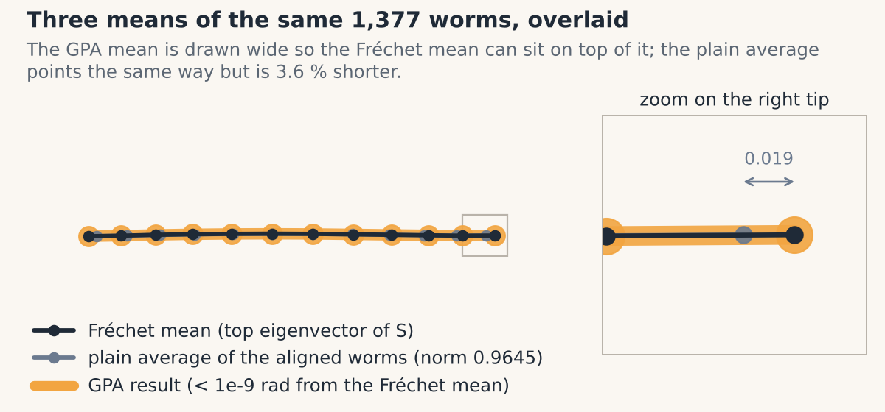
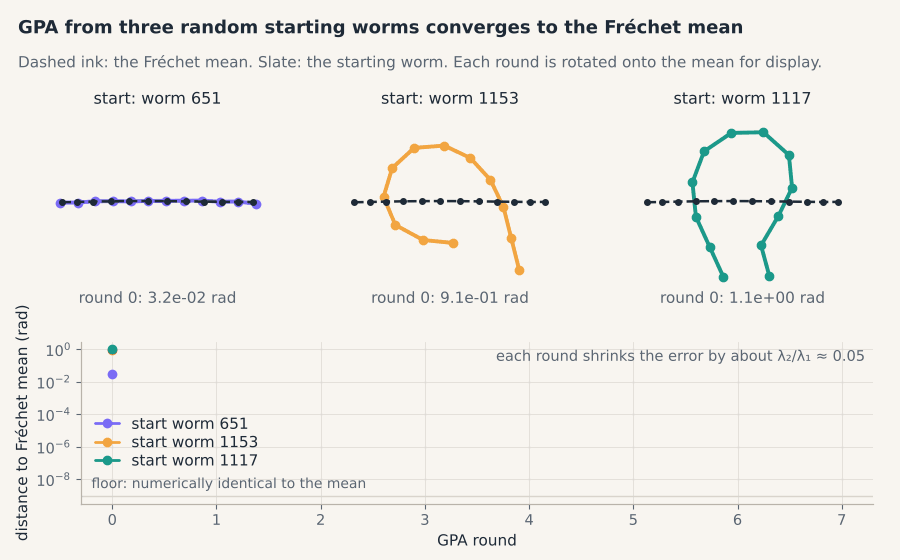

# 05 · Mean shapes

> **In one breath.** Averaging points on a sphere gives a point inside the sphere, so "the average worm" needs a definition that stays on the surface: the Fréchet mean, the shape closest on aggregate to all the others. With the Procrustes distance that mean is the top eigenvector of the matrix $S = \sum_i z_i z_i^{\mathsf H}$. The familiar recipe of aligning everything and averaging gives nearly the same shape, only shorter (norm 0.9645 on the worms). Generalized Procrustes Analysis, the iterative recipe, is power iteration in disguise and converges to the Fréchet mean, whatever the original tutorial's comment says.

## Why the plain average fails on a sphere

Average the positions of Tokyo and Buenos Aires as vectors from the Earth's center and you get a point deep underground: the average of points on a curved surface lies inside it, and the further apart the points, the deeper. Preshapes live on a sphere (Chapter 02), so a componentwise average of 1,377 unit-norm worms is not a unit-norm worm.

The way out is to stop averaging *coordinates* and ask instead for the point that minimizes the total squared *distance* to the data. On a flat space that is the ordinary average; on a curved one it stays on the surface. This is the **Fréchet mean**:

$$
m = \arg\min_{\lVert m \rVert = 1} \sum_{i=1}^{K} d(m, z_i)^2
$$

- **reading it:** $z_i$ is the $i$-th preshape in the dataset of $K$ shapes (1,377 worms); $d$ is a distance between shapes, invariant to rotation; $m$ is the candidate mean, constrained to norm 1 so it is itself a preshape; $\arg\min$ picks the candidate that makes the sum of squared distances smallest. Which $d$ you choose matters; the tutorial, and this guide, use the Procrustes distance of Chapter 04.
- **in shapekit:** `shapekit.shape_space.frechet_mean(Z)` for a `(K, N)` complex array.

## The mean is an eigenvector

With the Procrustes distance, $d(m, z_i)^2 = 2 - 2\,\lvert \langle m, z_i \rangle \rvert$, so minimizing the sum means making the inner products with $m$ large. The tutorial cites Dryden and Mardia, Result 8.2, for the fact that the minimizer is the top eigenvector of a particular matrix. [Unverified as to the book's exact statement] The sketch of why: maximizing the closely related $\sum_i \lvert \langle m, z_i \rangle \rvert^2$ is a textbook eigenvalue problem, because

$$
\sum_{i=1}^{K} \lvert \langle m, z_i \rangle \rvert^2 = m^{\mathsf H} S\, m, \qquad S = \sum_{i=1}^{K} z_i z_i^{\mathsf H}
$$

- **reading it:** $z_i$ is one preshape as a column of $N$ complex numbers; $z_i^{\mathsf H}$ is its conjugate transpose, a row; $z_i z_i^{\mathsf H}$ is an $N \times N$ table (12 × 12 for worms) whose entry $(k, l)$ is $z_{ik} \bar z_{il}$, the agreement between landmarks $k$ and $l$ of that worm; $S$ adds those tables over all worms; $m^{\mathsf H} S m$ is a single real number. The unit vector that maximizes it is the eigenvector of $S$ with the largest eigenvalue, and the maximum value is that eigenvalue.
- **in shapekit:** `frechet_mean` builds $S$, takes the top eigenvector with `numpy.linalg.eigh` ($S$ is Hermitian), then re-centers and re-normalizes it.

An eigenvector is defined only up to a complex factor, so the mean comes out at an arbitrary rotation: any $e^{i\theta} m$ is equally the mean. Two runs that give rotated copies of each other are both right. The re-centering is a formality: [Inference] $S$ maps centered vectors to centered vectors, so its eigenvectors are already centered.

On the C. elegans dataset the top eigenvalue of $S$ is **1291.5 out of a possible 1,377** (the trace of $S$ equals $K$, since each $z_i$ has norm 1; re-computed). The ratio 0.938 is the average over worms of $\lvert \langle m, z_i \rangle \rvert^2 = \cos^2 \rho_i$: the worms agree strongly, and the mean worm is an almost straight line. The second eigenvalue is 66.2, which matters below.


*Three means of the same 1,377 worms. Fréchet mean (ink), plain average of the aligned worms (slate, norm 0.9645, so slightly shorter), and the Generalized Procrustes result (gold, overlapping the Fréchet mean).*

## The plain average, and why it is shorter

The recipe everyone tries first: align every worm to the Fréchet mean with Chapter 03's one-liner, then average the aligned preshapes landmark by landmark. The result points in almost exactly the direction of the Fréchet mean, but its norm is **0.9645**, not 1 (re-computed from the dataset).

The reason is the underground city again. Each aligned worm is a unit vector; they point in slightly different directions; the average of unit vectors pointing in different directions is shorter than 1. A hand version: two unit arrows at $+30^\circ$ and $-30^\circ$ from the horizontal, $(0.866, 0.5)$ and $(0.866, -0.5)$, average to $(0.866, 0)$, length $\cos 30^\circ = 0.866$. The direction is right; the length is the cosine of the spread. For the worms the spread is small, so the shrinkage is only 3.6 %. Renormalize the plain average and you have, to good accuracy, the Fréchet mean back; the tutorial's own solution plot shows this overlay.

So the plain average is not wrong, just not on the sphere. It also cannot be computed without a reference to align to, which is the circular problem the next section solves.

## Generalized Procrustes Analysis is power iteration

**Generalized Procrustes Analysis** (GPA) is the classical answer to "how do I align shapes to a mean I do not have yet?":

1. Pick a random worm as the reference.
2. Align every worm to it.
3. Average the aligned worms and rescale to norm 1; call that the new reference.
4. Repeat 2 and 3 until the reference stops changing.

The original tutorial's solution runs this and comments: *"The nature of the mean shape changes depending on the initial reference and it is completely different from the Fréchet mean!"* This is not what happens. Re-running the tutorial's own loop from six random starting worms, the result landed within about $10^{-5}$ of the Fréchet mean every time, within a couple of rounds. What *does* change with the starting worm is the rotation of the plotted result: the mean is defined only up to rotation, and GPA inherits the orientation of its first reference. Plotted side by side without aligning them, two correct means can look "completely different".

Why it must converge there. In the tutorial's code, each worm is multiplied by its inner product with the reference, $\langle z_i, r \rangle\, z_i$ (the full complex number, not just its unit-length phase), then everything is averaged and rescaled:

$$
r_{\text{new}} = \frac{\sum_i \langle z_i, r \rangle\, z_i}{\big\lVert \sum_i \langle z_i, r \rangle\, z_i \big\rVert} = \frac{S\, r}{\lVert S\, r \rVert}
$$

- **reading it:** $r$ is the current reference; $\langle z_i, r \rangle = z_i^{\mathsf H} r$ is a complex weight whose angle rotates $z_i$ onto $r$ and whose length is $\cos \rho_i$; the weighted sum is exactly $S r$ with $S$ the matrix from the previous section (the factor $1/K$ cancels in the normalization); $r_{\text{new}}$ is that vector rescaled to norm 1.

"Multiply by $S$, rescale, repeat" is **power iteration**, the standard algorithm for the top eigenvector of a matrix. Each round the component along the top eigenvector grows by $\lambda_1$ and the component along the second by $\lambda_2$, so the error shrinks by $\lambda_2 / \lambda_1$ per round. For the worms that is $66.2 / 1291.5 \approx 0.05$ (re-computed): three rounds take an initial error of $10^{-3}$ to $10^{-6}$, which is what the re-computation observed. From any starting worm not exactly perpendicular to the mean, GPA walks to the Fréchet mean, because that is the only place power iteration can stop.


*GPA from three random starting worms. After every round the reference is rotated onto the Fréchet mean for display; all three converge on it within a few rounds.*

**Worked example on a 2 × 2 matrix.** $S = \begin{pmatrix} 3 & 1 \\ 1 & 1 \end{pmatrix}$, start $r = (1, 0)$. Round 1: $S r = (3, 1)$, rescaled $(0.949, 0.316)$. Round 2: $S r = (3.162, 1.265)$, rescaled $(0.928, 0.371)$. Round 3: $(0.925, 0.381)$. Round 4: $(0.924, 0.382)$. The exact top eigenvector is $(0.924, 0.383)$ with eigenvalue $2 + \sqrt 2 = 3.414$; the other eigenvalue is $0.586$, ratio 0.17, so each round removes about five-sixths of the remaining error, which matches the digits.

**One honest caveat.** The argument is for the loop as the tutorial wrote it, with the full complex weight. Textbook GPA rotates each worm by the *unit-length* phase $e^{i\theta_i^\ast}$ only, then averages. That variant is no longer exactly $S r$, and its fixed point differs slightly from the eigenvector mean: on the worms the two land 0.007 apart in Procrustes distance (re-computed), about a tenth of a typical worm's distance from the mean and invisible in a plot. Both converge; both are reasonable means; neither is "completely different". `shapekit.procrustes.gpa_mean` implements the full-weight loop by default (`weighted=True`), which is why its tests demand agreement with `frechet_mean` to $10^{-6}$ from any starting worm; pass `weighted=False` for the textbook phase-only variant and you will see the 0.007 gap. `return_history=True` returns every iterate, already rotated onto the final mean, so you can watch the convergence.

## Why it matters in the lab

A mean shape is the reference for everything downstream: alignment, distances from "typical", and the point where the tangent plane of Chapter 06 touches the sphere. An eigenvector gives it exactly; GPA gives the same answer, so use whichever your software offers. The deeper lesson is about comments: a confident remark in a solution notebook was wrong, and it was wrong because nobody rotated the two means onto each other before comparing their pictures. Chapter 09 collects more such stories.

## Try it

```python
import numpy as np
from shapekit.datasets import load_celegans
from shapekit.preshape import preshape, to_complex
from shapekit.procrustes import align_dataset, gpa_mean
from shapekit.shape_space import frechet_mean, procrustes_distance

Z = to_complex(preshape(load_celegans()[0]))         # (1377, 12)
m = frechet_mean(Z)

S = Z.T @ Z.conj()                                   # sum_i z_i z_i^H, 12 x 12
w = np.linalg.eigvalsh(S)
print(w[-1], w[-2], w.sum())                         # ~1291.5, ~66.2, 1377.0

plain = align_dataset(Z, m).mean(axis=0)
print(np.linalg.norm(plain))                         # ~0.9645: shorter than 1
print(procrustes_distance(plain / np.linalg.norm(plain), m))   # tiny: same direction

for seed in (0, 1, 2):
    print(seed, procrustes_distance(gpa_mean(Z, seed=seed), m))   # same answer from every start
```

## Check yourself

<details><summary>1. Why is the plain average of aligned preshapes shorter than 1, and does that make its direction wrong?</summary>

It averages unit vectors that point in slightly different directions, and such an average is shorter than its parts (two unit arrows 60° apart average to length 0.866). The direction is nearly right; renormalizing recovers the Fréchet mean to good accuracy. On the worms the shrinkage is 1 − 0.9645 ≈ 3.6 %.
</details>

<details><summary>2. The top eigenvalue of $S$ is 1291.5 and its trace is 1377. What does the ratio tell you?</summary>

That the average of $\cos^2 \rho_i$ over worms is 0.938: the worms cluster tightly around the mean. It also makes power iteration (GPA) converge fast, about three rounds here.
</details>

<details><summary>3. Two GPA runs from different random starts produce means that look rotated relative to each other. Bug?</summary>

No. The mean is defined only up to rotation, and each GPA run inherits the orientation of its starting reference. Rotate one onto the other with `shapekit.procrustes.align` and compare again; the Procrustes distance between them should be around $10^{-5}$ or smaller.
</details>

## Credits

Adapted from notebook 2A (*Discrete Shape Analysis*) of *Shape Analysis 101* by Johannes Hugger and Virginie Uhlmann (Uhlmann group, EMBL-EBI, 2021; BSD-3): the eigenvector form of the Fréchet mean follows Dryden & Mardia (2016), Result 8.2, as the tutorial cites it; the GPA loop is the tutorial's, re-analysed here. The quoted comment is theirs and is marked as a quotation.

**Next:** [06 · Tangent space and PCA](06-tangent-space-and-pca.md)
