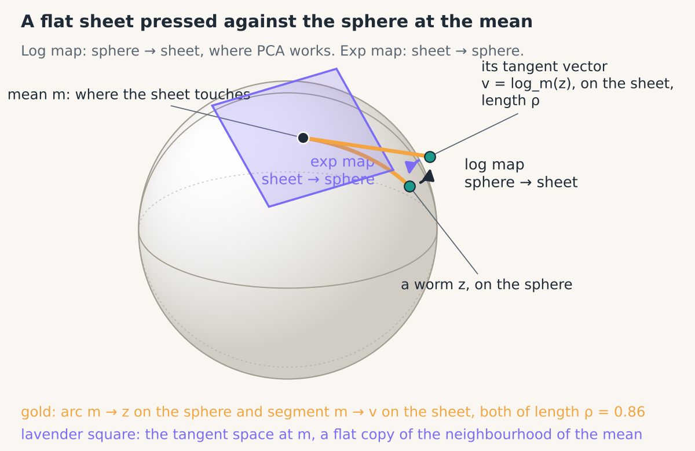
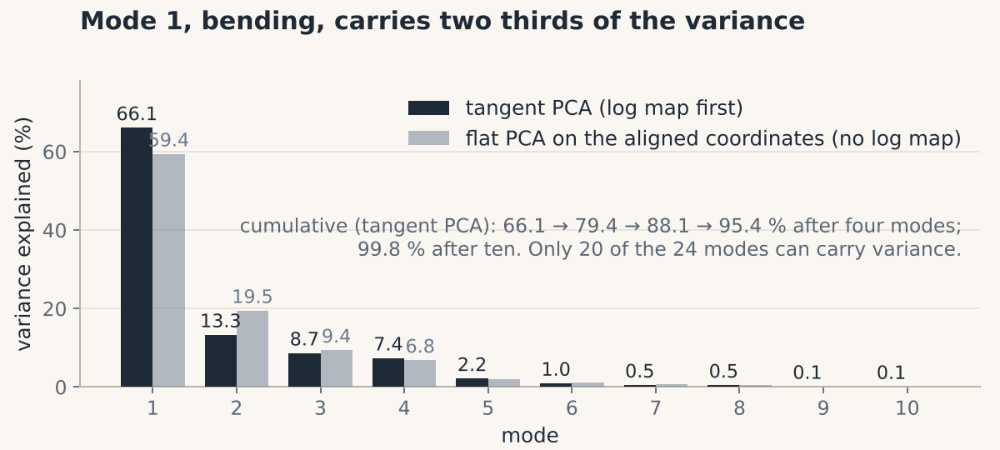
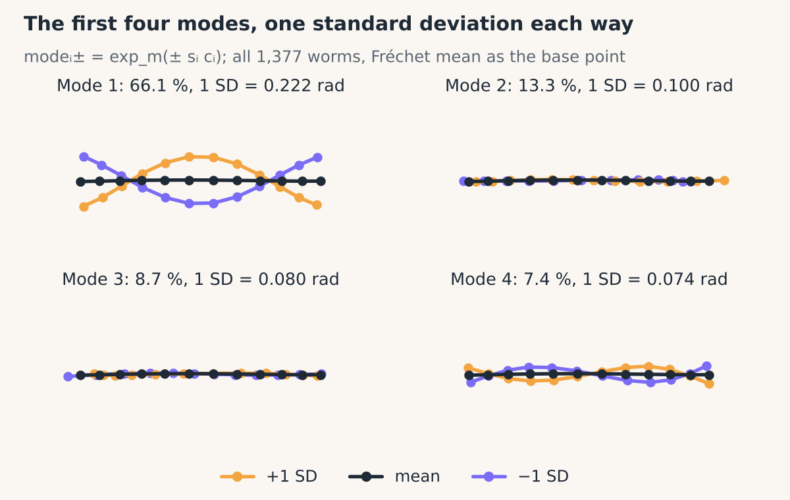
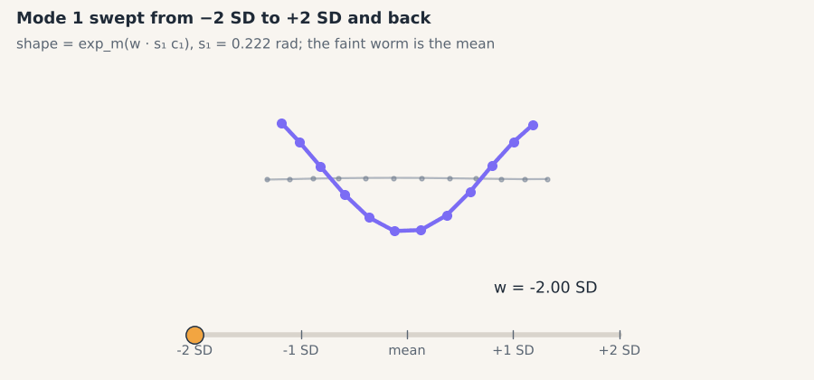
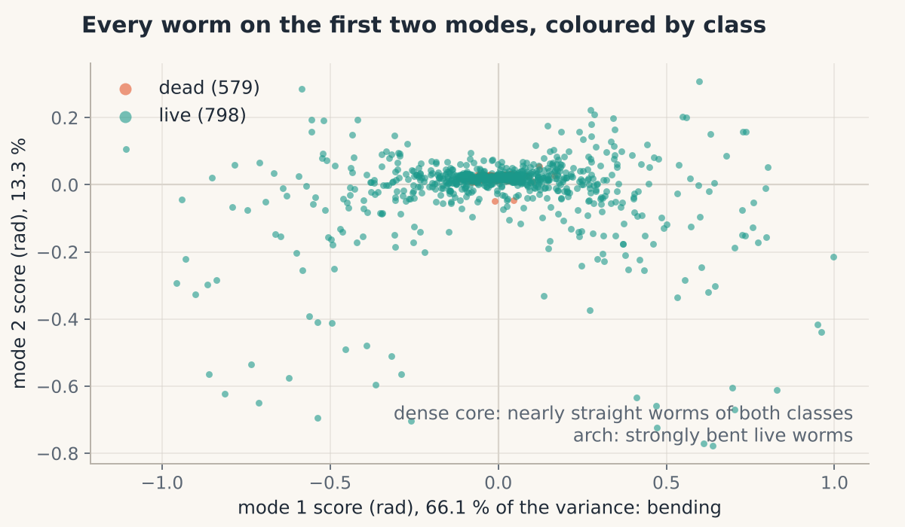
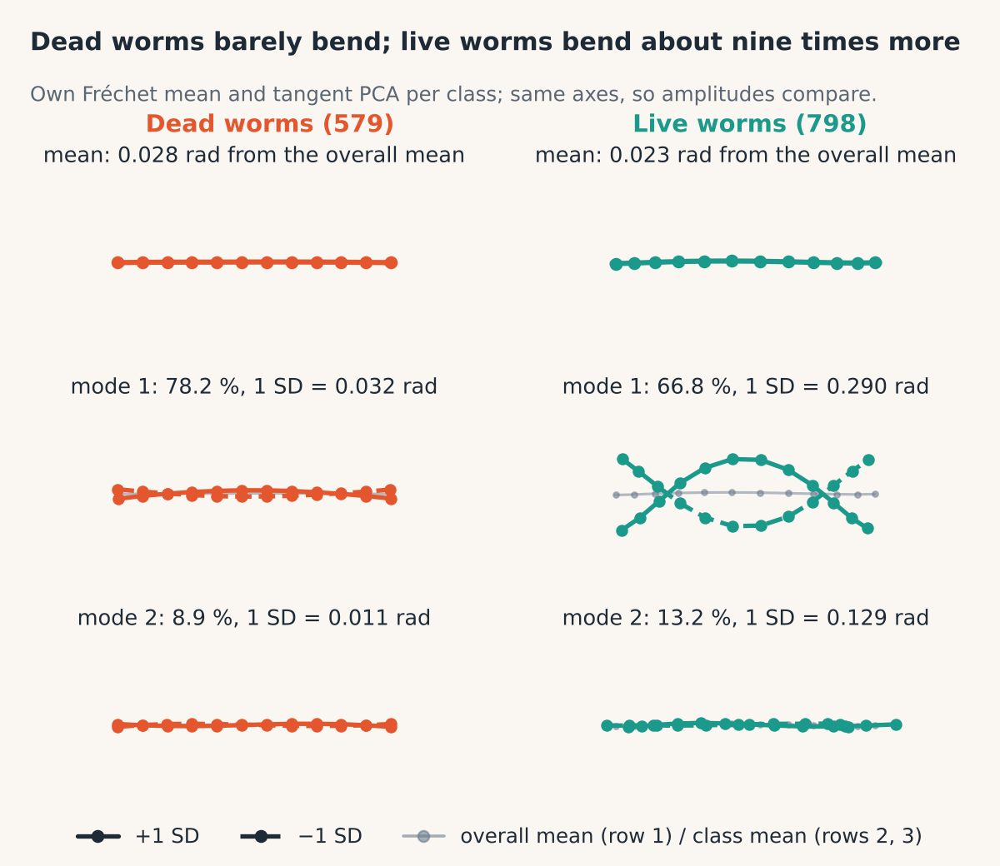
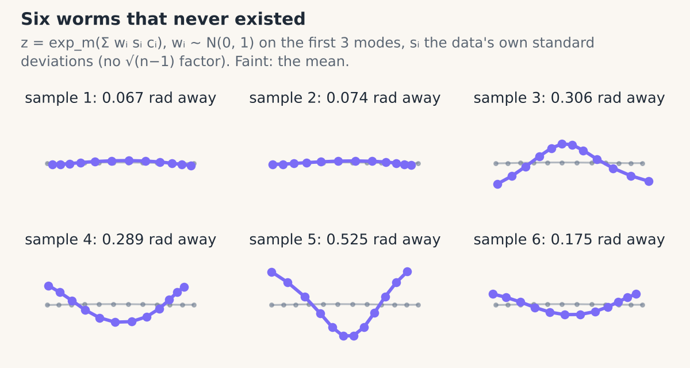

# 06 · Tangent space and PCA

> **In one breath.** Shape space is curved and PCA only works on flat data, so we press a flat sheet against the sphere at the mean shape, copy every worm onto the sheet with the log map, run PCA there, and carry the answers back to the sphere with the exp map. On the *C. elegans* landmarks the first mode is bending and explains 66.1% of the variance; dead worms barely bend, live worms bend about nine times more.

## A flat map on a globe

Chapter 04 put every preshape on a sphere. Chapter 05 found the point on that sphere that the worms agree on most, the Fréchet mean $m$. The next question is the one biologists usually care about: *in which ways* do worms differ from the mean, and how much of the variation does each way account for?

Principal component analysis (PCA) answers exactly that question, but it assumes ordinary straight-line arithmetic: you can add shapes, average them, and the average is still a shape. On a sphere that is false. Add two points on a globe and you land underground.

The way out is the oldest trick in cartography. Lay a flat sheet of paper on the globe so that it touches at one city. Near the city, distances and directions on the paper are faithful. Far from it they distort. That sheet is the **tangent space** at $m$, and because the worms cluster tightly around their mean (the top eigenvalue in Chapter 05 was 1291.5 out of a possible 1377), the sheet is a faithful map of where the data actually lives.


*The sphere of preshapes, the flat sheet touching it at the mean, and the two maps that move shapes between them.*

## Two maps: up to the sheet, back to the sphere

The **log map** takes a shape on the sphere and marks the matching point on the sheet. It first rotates the shape onto the mean with the one-line formula of Chapter 03, then records the direction away from the mean, scaled so that the arrow's length is the geodesic distance $\rho$.

$$
v = \operatorname{Log}_m(z) = \frac{\rho}{\sin \rho}\left(e^{i\theta} z - \cos\rho \; m\right), \qquad \rho = \arccos\lvert m^{H} z \rvert
$$

Reading it:
- $m$: the mean preshape, 12 complex numbers.
- $z$: the worm being mapped; $e^{i\theta} z$ is the same worm after its best rotation onto $m$.
- $\rho$: the geodesic distance from $m$ to $z$ (Chapter 04); $m^{H}$ is the conjugate transpose.
- $\cos\rho \; m$: the part of the rotated worm that points along the mean. Subtracting it leaves only what is at right angles to $m$, which is what "on the sheet" means.
- $\rho / \sin\rho$: a stretch factor so that the arrow $v$ has length exactly $\rho$.
- Implemented by `shapekit.shape_space.log_map(mean, z)`.

The **exp map** reverses it: start at $m$, walk distance $t$ across the sphere in direction $v$.

$$
\operatorname{Exp}_m(v) = \cos t \; m + \frac{\sin t}{t}\, v, \qquad t = \lVert v \rVert
$$

Reading it:
- $v$: a tangent vector (24 real numbers, or 12 complex ones), at right angles to $m$.
- $t$: its length, which is the distance to walk in radians.
- $\cos t \; m$: how much of the destination still points along the mean; $\frac{\sin t}{t} v$: how much points sideways.
- Implemented by `shapekit.shape_space.exp_map(mean, v)`.

**Worked example.** Take $t = 0.3$. Then $\cos 0.3 = 0.9553$ and $\sin 0.3 / 0.3 = 0.2955 / 0.3 = 0.9851$, so the result is $0.9553\,m + 0.9851\,v$. Does it still sit on the unit sphere? Its squared length is $0.9553^2 + (0.9851 \times 0.3)^2 = 0.9126 + 0.0873 = 0.9999$, which is 1 up to rounding, because $v \perp m$ and $\cos^2 t + \sin^2 t = 1$. Any $t$ works; the pitfall section shows what goes wrong when $t$ gets large.

## PCA on the sheet

After the log map every worm is a row of 24 real numbers: 12 real parts followed by 12 imaginary parts. Stack the $K = 1377$ rows into a matrix $V$ and compute the covariance.

$$
C = \frac{1}{K-1}\,(V - \bar V)^{T}(V - \bar V), \qquad C\,c_i = \lambda_i\, c_i, \qquad \text{explained}_i = \frac{\lambda_i}{\sum_j \lambda_j}
$$

Reading it:
- $V$: the $K \times 24$ matrix of tangent vectors; $\bar V$ its column means (close to zero when $m$ is the Fréchet mean, but subtracted anyway).
- $C$: the $24 \times 24$ covariance; entry $(a, b)$ says how coordinate $a$ co-varies with coordinate $b$.
- $c_i$: the $i$-th **principal component**, a direction on the sheet; $\lambda_i$: the variance of the data along it.
- $\text{explained}_i$: the fraction of all variance that direction carries. The components are sorted so that $\lambda_1 \ge \lambda_2 \ge \dots$
- Implemented by `shapekit.tangent_pca.TangentPCA(mean).fit(Z)`, which exposes `explained_variance_ratio_` and `transform(Z)` for the scores $a_i = (v - \bar V)\cdot c_i$.

**Worked example you can do by hand.** Four points in a plane: $(2,0)$, $(-2,0)$, $(0,1)$, $(0,-1)$. The mean is $(0,0)$. The variance along $x$ is $(4+4+0+0)/3 = 8/3$; along $y$ it is $(0+0+1+1)/3 = 2/3$. The two directions do not co-vary, so they *are* the components, and mode 1 explains $(8/3)/(10/3) = 80\%$, mode 2 the remaining 20%. The same arithmetic, in 24 dimensions, produces the scree plot below.


*Variance explained by each mode. Tangent PCA (solid) against PCA run directly on the aligned coordinates without the log map (faint).*

**Results on the 1377 worms.** Tangent PCA explains 66.1%, 13.3%, 8.7%, 7.4%, 2.2% and 1.0% with its first six modes; the first four together cover about 95%. Flat PCA on the same aligned shapes gives 59.4%, 19.5%, 9.4% and 6.8%: treating the curved space as flat shuffles variance between modes, which is the point of the comparison.

### Why only 20 of the 24 directions carry variance

Each tangent vector has 24 numbers, but the last four components come out with zero variance. Nothing is broken. A configuration of 12 points in the plane has $24$ degrees of freedom; removing position costs $2$, size $1$ and rotation $1$, leaving $2 \times 12 - 4 = 20$ shape dimensions (Kendall 1984). The sheet is really 20-dimensional, drawn inside a 24-dimensional room.

## Modes of variation

A component $c_i$ is a direction, not a worm. To *see* it, walk from the mean along $c_i$ by one standard deviation $s_i = \sqrt{\lambda_i}$ in each direction and map back:

$$
\text{mode}_i^{\pm} = \operatorname{Exp}_m\!\left(\pm\, s_i\, c_i\right)
$$

- $s_i$: the standard deviation of the scores along mode $i$, so "$\pm 1$ SD" is a typical worm, not an extreme one.
- Implemented by `TangentPCA.mode_shape(i, n_sd=1.0)`, which returns the pair.


*The first four modes. Mode 1 is bending: the worm curls into a C in one direction or the other.*


*Mode 1 swept continuously from −2 SD to +2 SD and back.*

<div class="demo" data-demo="pca-modes"></div>


*Scores on the first two modes. Coral = dead, teal = live. The cloud is a dense core plus an arch of strongly bent worms.*

## Dead versus live

Running the whole chain per class (its own Fréchet mean, its own tangent PCA) gives the main biological finding of the tutorial. Results on these datasets:

| Class | Mode 1 | Mode 2 | Active modes | Mode 1, one standard deviation |
|---|---|---|---|---|
| Dead (579 worms) | 78.2% | 8.9% | 20 | 0.032 rad |
| Live (798 worms) | 66.8% | 13.2% | 20 | 0.290 rad |

Dead worms are nearly straight rods, and what little variation they have is almost all in one mode. Live worms bend about nine times more in mode 1 (0.290 / 0.032 ≈ 9, re-computed with `scripts/make_figures.py`), and they are the arch in the scatter plot. The two class means sit within 0.028 (dead) and 0.023 (live) radians of the overall mean, so the classes differ in their *spread* of shapes, not in their average shape. (The tutorial's own plots suggest "8–10 times"; the figure here measures it.)


*Left: dead-worm mean and modes (coral). Right: live-worm mean and modes (teal). Note the different amplitude of mode 1.*

## Generating shapes from a Gaussian

If the scores along each mode look roughly bell-shaped, you can run the machine backwards and invent plausible worms. Draw standard normal numbers $w_i$, scale each by its mode's standard deviation, add up on the sheet, and map down:

$$
z_{\text{new}} = \operatorname{Exp}_m\!\left(\sum_{i=1}^{q} w_i\, s_i\, c_i\right), \qquad w_i \sim \mathcal{N}(0, 1)
$$

- $q$: how many modes to use (the tutorial used 3).
- $w_i$: a random number with mean 0 and standard deviation 1; $s_i$ turns it into a displacement in the data's own units.
- Implemented by `TangentPCA.sample(n, n_modes, seed)`.


*Six worms that never existed, sampled with the correct scaling.*

### The $\sqrt{n-1}$ pitfall

The tutorial's saved figure for this step shows jumbled point sets, not worms. [Inference] The cause is one factor: the code scaled each $w_i$ by $\sqrt{\lambda_i (n-1)}$ instead of $\sqrt{\lambda_i}$. That quantity is the singular value of the data matrix, the "total" spread over all $n$ worms, not the per-worm standard deviation. For the 798 live worms $\sqrt{n-1} \approx 28$.

Why it ruins everything: suppose, for illustration only, that $s_1 = 0.05$ radians. A 1-SD step along mode 1 should move 0.05 radians across the sphere. Multiplied by 28 it becomes 1.4 radians. But no two preshapes can be farther apart than $\pi/2 \approx 1.57$ radians, so a 1.4-radian walk goes most of the way to the opposite side of the sphere, and the exp map wraps the sample around into coordinates that no longer resemble a worm. The lesson generalizes: whenever you sample, check that the tangent vector lengths you generate are the same size as the lengths `log_map` produced from real data.

Two more honest caveats. A Gaussian assumes the cloud of scores is an ellipse, but the scatter plot shows an arch, so a three-mode Gaussian will under-produce strongly bent worms. [Inference] And the sheet is only accurate near the mean; samples with $t$ near 1 radian are being generated in a region the map distorts.

## Try it

```python
import numpy as np
from shapekit.datasets import load_celegans
from shapekit.preshape import preshape, to_complex
from shapekit.shape_space import frechet_mean, log_map, exp_map
from shapekit.tangent_pca import TangentPCA

points, labels = load_celegans()                 # (1377, 12, 2), (1377,)
Z = to_complex(preshape(points))                 # (1377, 12) complex
m = frechet_mean(Z)
pca = TangentPCA(mean=m).fit(Z)
print(np.round(pca.explained_variance_ratio_[:6] * 100, 1))   # expect ~66.1 13.3 8.7 7.4 2.2 1.0
plus, minus = pca.mode_shape(0, n_sd=1.0)
v = log_map(m, Z[0]); print(np.linalg.norm(v))                # geodesic distance of worm 0
synthetic = pca.sample(6, n_modes=3, seed=0)
```

## Check yourself

<details><summary>1. Why not run PCA directly on the aligned preshapes?</summary>
Because preshapes live on a sphere, and PCA's averages and straight-line distances are only meaningful on a flat space. You can do it (the "flat PCA" curve in the scree plot), and on tightly clustered data the answer is similar, but variance leaks between modes: 59.4% versus 66.1% for mode 1 here.
</details>

<details><summary>2. A tangent vector has length 0.3. What is the geodesic distance between the mean and the shape it maps to?</summary>
Exactly 0.3 radians. The exp map walks distance $t = \lVert v \rVert$ across the sphere, and the log map is built so that $\lVert v \rVert = \rho$.
</details>

<details><summary>3. You sample from the Gaussian and get tangled shapes. What is the first thing to check?</summary>
The scale of your tangent vectors. Compare the lengths of the vectors you generate with the lengths of <code>log_map(mean, z)</code> for real worms. If yours are tens of times longer, you are multiplying by something like $\sqrt{n-1}$ that belongs to a singular value, not a standard deviation.
</details>

## Credits

Adapted from notebook 2A, sections 3–5, of *Shape Analysis 101* by Johannes Hugger and Virginie Uhlmann (Uhlmann group, EMBL-EBI, 2021; BSD-3): tangent-space PCA, the dead-versus-live comparison and the statistical shape model are their exercises; the numbers are re-computed with `shapekit` on their data. Theory per Dryden & Mardia (2016).

**Next:** [07 · Shapes as smooth curves](07-splines.md)
