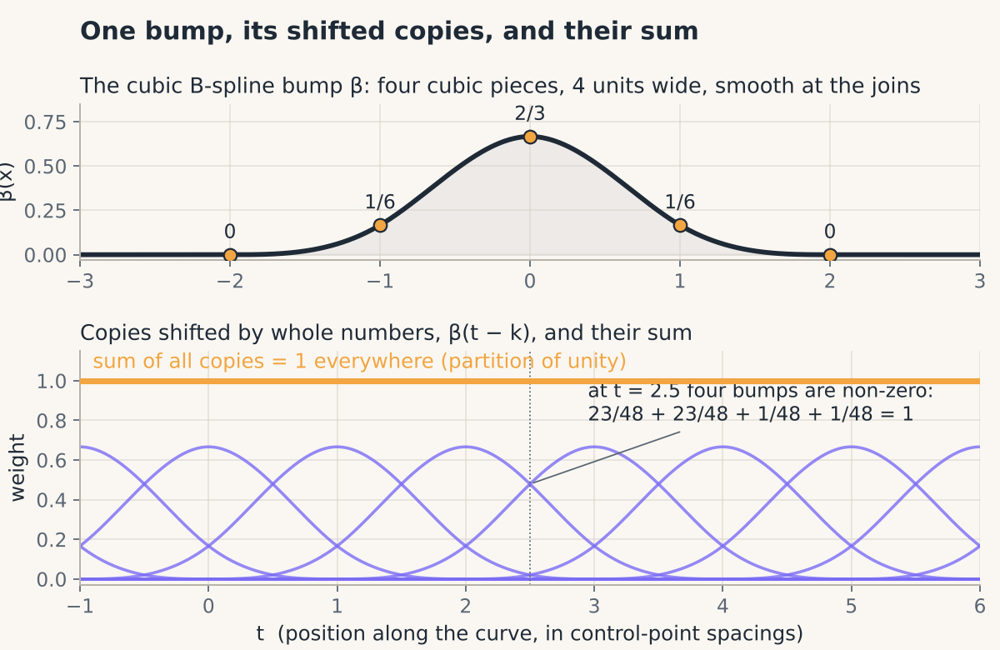
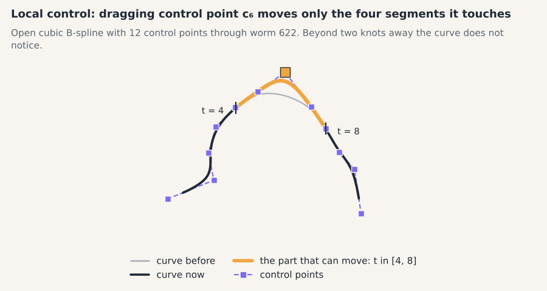
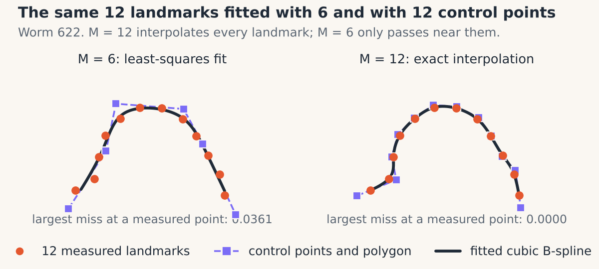

# 07 · Shapes as smooth curves

> **In one breath.** A worm is a continuous line, not 12 dots. A cubic B-spline describes such a line with a few control points, each of which pulls on only the nearby stretch of curve. Finding control points so that the curve passes through measured points is an "un-blurring" that a two-sweep recursive filter does exactly, and one small table, the Gram matrix Φ, lets every formula from Chapters 02 to 06 compare whole curves instead of dots.

## Magnets on a flexible ruler

Picture a thin flexible ruler lying on the bench and a row of magnets placed along it, one unit apart. Each magnet pulls the part of the ruler near it. Move one magnet and only the nearby stretch of ruler follows; the far end does not notice. Each magnet is a **control point** $c_k$, and the ruler is the curve.

The pull of one magnet, as a function of distance along the ruler, is the **cubic B-spline bump** $\beta$:

$$
\beta(x) =
\begin{cases}
\dfrac{2}{3} - x^2 + \dfrac{\lvert x\rvert^3}{2} & \lvert x\rvert < 1 \\[6pt]
\dfrac{(2 - \lvert x\rvert)^3}{6} & 1 \le \lvert x\rvert \le 2 \\[6pt]
0 & \text{otherwise}
\end{cases}
$$

Reading it:
- $x$: distance from the magnet, in units of magnet spacing.
- The inner piece is a rounded hilltop; the outer piece is the smooth skirt that reaches zero at $\pm 2$. Where they meet, at $\lvert x \rvert = 1$, value, slope and curvature all agree, which is why the curve looks smooth and not kinked.
- Implemented by `shapekit.bspline.cubic_bspline(x)`.

**Worked example.** At $x = 0$: $2/3$. At $x = 1$, inner formula: $2/3 - 1 + 1/2 = 1/6$; outer formula: $1^3/6 = 1/6$, the same. At $x = 2$: $0$. At $x = 0.5$: $2/3 - 1/4 + 1/16 = 23/48 \approx 0.479$. At $x = 1.5$: $0.5^3/6 = 1/48 \approx 0.021$.

Now add the bumps of all the magnets at any point: at $x = 0.5$ the four bumps within reach contribute $23/48 + 23/48 + 1/48 + 1/48 = 48/48 = 1$. At a whole number the weights are $1/6, 4/6, 1/6$, again summing to 1. The bumps always sum to 1 (a "partition of unity"). Consequence: shifting every control point by the same vector shifts the whole curve by exactly that vector, which is what lets Chapter 02's centering work on control points.


*The bump $\beta$, its copies shifted by whole numbers, and their sum: exactly 1 everywhere.*

## The curve is a sum of bumps

$$
\mathbf{r}(t) = \sum_{k} c_k\, \beta(t - k)
$$

- $t$: position along the curve, a real number; $t = 3.5$ is halfway between the third and fourth magnets.
- $c_k$: control point $k$, an $(x, y)$ pair, or a complex number as in Chapter 03.
- $\beta(t - k)$: the bump centered on magnet $k$. Only the four magnets within distance 2 of $t$ contribute; that is **local control**.
- Implemented by `shapekit.bspline.BSplineCurve(M, closed).sample(n_points)`, which evaluates $\mathbf{r}$ at `n_points` evenly spaced values of $t$ along the whole curve.

At whole numbers the curve takes an especially simple form, because only three bumps are non-zero there:

$$
\mathbf{r}(k) = \frac{c_{k-1} + 4\,c_k + c_{k+1}}{6}
$$

This is the **1-4-1 blur**: each sampled point is a weighted average of a magnet and its two neighbors. Worked example: control points $(0, 0, 1, 0, 0)$ along one axis give samples $(0, 1/6, 2/3, 1/6, 0)$.


*Local control: dragging one control point moves only the four segments it touches.*

## Fitting is un-blurring: the recursive filter

Here is the practical problem. You have $M$ measured points $s_k$ along a worm (Chapter 01 gave you 20, equally spaced by arc length) and you want a curve that passes *through* them. You need control points $c_k$ whose 1-4-1 blur reproduces the samples. Fitting is un-blurring.

You could write the $M$ equations and solve them as a matrix. Unser's observation (1999) is that the 1-4-1 blur can be undone exactly by two one-directional sweeps with a fading memory. The whole fit is a few lines:

$$
\begin{aligned}
c^{+}_k &= s_k + p\, c^{+}_{k-1} && \text{(forward sweep, left to right)} \\
c^{-}_k &= p\,\left(c^{-}_{k+1} - c^{+}_k\right) && \text{(backward sweep, right to left)} \\
c_k &= 6\, c^{-}_k \\
p &= -2 + \sqrt{3} \approx -0.268
\end{aligned}
$$

Reading it:
- $s_k$: the measured points. $c^{+}$: the half-processed result after the forward sweep; $c^{-}$: after the backward sweep.
- $p$: the **pole**, the filter's memory. Each sweep's output at $k$ is $s_k + p\,s_{k-1} + p^2 s_{k-2} + \dots$: the sample one step back counts with weight $-0.268$, two steps back $0.072$, three $-0.019$, four $0.005$. Memory fades by a factor of 0.268 per step, alternating in sign.
- The factor 6 undoes the $1/6$ in the blur.
- Implemented by `shapekit.bspline.interpolation_filter(samples, closed=False)`.

Why that particular $p$? Write the blur as "one step back, plus 4 times here, plus one step forward". The polynomial $x^2 + 4x + 1$ has two roots, $p = -0.268$ and $1/p = -3.732$, whose sum is $-4$ and whose product is $1$ (check: $-0.268 - 3.732 = -4.000$ and $0.268 \times 3.732 = 1.000$). The blur factors into one piece that looks backward and one that looks forward, and each sweep divides out one piece. Only the root inside $(-1, 1)$ gives a memory that fades rather than explodes, and $p$ is that root.

**Worked example.** Feed in a long row of samples all equal to 1. The forward sweep settles at $c^{+} = 1/(1 - p) = 1/1.268 = 0.789$. The backward sweep settles where $c^{-} = p\,(c^{-} - 0.789)$, that is $c^{-} = -p \times 0.789 / (1 - p) = 0.268 \times 0.789 / 1.268 = 0.167 = 1/6$. Times 6: the control points are all 1. That is right, because the 1-4-1 blur of a flat row of ones is $(1 + 4 + 1)/6 = 1$. The filter is an exact inverse: the curve passes through every measured point.

**Ends.** A worm is an open curve, so the sweeps need a rule at the two ends. The tutorial's toolbox repeats each end point twice before filtering, which is why $M$ measured points produce $M + 4$ control points (more on this below). For a closed outline, such as a cell, the sweeps wrap around instead (`closed=True`).


*The same worm fitted with 6 and with 12 control points. The control polygon (dashed) is the row of magnets. With M = 12 the curve passes exactly through the 12 measured points (interpolation); with M = 6 it passes near them (a least-squares fit, largest miss 0.036 in preshape units).*

<div class="demo" data-demo="bspline"></div>

## The Gram matrix Φ: overlap of the bumps

Chapters 02 to 06 compared shapes with one operation: the sum of products of matching points, $z^{H} w$. With curves, a control point is not a point *on* the shape, so comparing magnets one by one would compare the wrong thing. We want to compare the curves themselves, over their whole length:

$$
\langle z, w \rangle_{\Phi} = \int \overline{z(t)}\, w(t)\, dt = z^{H} \Phi\, w, \qquad \Phi_{kl} = \int \beta(t - k)\, \beta(t - l)\, dt
$$

Reading it:
- $z, w$: two curves, each given by its vector of complex control points.
- $\Phi$: the **Gram matrix**, an $M \times M$ table whose entry $(k, l)$ is how much bump $k$ and bump $l$ overlap. Two curves overlap by as much as their bumps do, weighted by the control points.
- Implemented by `shapekit.bspline.gram_matrix(M)`.

Because all bumps are the same shape, $\Phi_{kl}$ depends only on $\lvert k - l \rvert$. Numerical integration gives $0.4794$ for a bump with itself, $0.2363$ for neighbors one step apart, $0.0238$ for two steps, $0.0002$ for three, and $0$ beyond (these are $2416/5040$, $1191/5040$, $120/5040$ and $1/5040$, the values of the degree-7 B-spline at whole numbers; Unser 1999). They sum to 1 across a row, as the partition of unity demands: $0.4794 + 2(0.2363 + 0.0238 + 0.0002) = 1.000$. So a bump shares about half as much ground with its neighbor as with itself.

With $\Phi$ in hand, every formula of the earlier chapters survives with $\Phi$ slipped into the middle:

| Chapter | Landmarks | Curves |
|---|---|---|
| 02 size | $\lVert z \rVert = \sqrt{z^{H} z}$ | $\sqrt{z^{H} \Phi z}$ |
| 03 rotation | $\theta = \operatorname{angle}(z^{H} w)$ | $\operatorname{angle}(z^{H} \Phi w)$ |
| 04 geodesic | $\arccos\lvert z^{H} w\rvert$ | $\arccos\lvert z^{H} \Phi w\rvert$ |
| 05 Fréchet mean | top eigenvector of $\sum_i z_i z_i^{H}$ | top eigenvector of $\sum_i z_i z_i^{H} \Phi$ |
| 06 tangent PCA | PCA on tangent vectors | PCA on tangent vectors multiplied by $\sqrt{\Psi}$, $\Psi = \Phi \oplus \Phi$ |

The last row is the one new idea: multiplying the 24-or-so real tangent coordinates by the square root of $\Psi$ (one copy of $\Phi$ for the real parts, one for the imaginary parts) makes plain straight-line distance between rows equal to the curve distance, so ordinary PCA applies. [Inference] from the algebra of the tutorial's `B3_PCA`; the step is standard but was not run here.

The tutorial prints no numbers for its spline pipeline, only figures, so no percentages are quoted here. [Inference] Since the same 1377 worms go in, the spline version should reproduce the landmark story of Chapter 06: a nearly straight mean, bending as mode 1, live worms bending more than dead ones. Run the Try-it snippet to see for yourself.

## M versus M + 4

The stored worm splines in the tutorial have $M = 6$ but carry 10 coefficient pairs, because of the end-point padding described above. The tutorial's text says a worm is described by 6 complex numbers; its code uses 10. Both counts are in play, and you must know which one your Gram matrix was built for: $\Phi$ must be $10 \times 10$ to multiply a 10-coefficient curve.

Two further points to carry forward. [Unverified] For open curves the tutorial uses the *periodic* (wrap-around) $\Phi$ with the $M + 4$ coefficients; whether that matches the open-curve treatment in Song et al. (2020) was not checked against the paper. And the number of control points is a modeling choice: $M = 6$ captures the bend of a worm and little else; $M = 12$ follows small wiggles that may be segmentation noise.

`shapekit` takes a different route from the tutorial here, on purpose: `BSplineCurve(M, closed=False)` stores **exactly $M$ control points** and handles the ends by *mirroring* ($c_{-1} = c_{1}$, $c_{M} = c_{M-2}$), so there is no padding and no $M + 4$ to keep track of. The curve still passes exactly through $M$ given points (`fit` interpolates when you give it $M$ points and does a least-squares fit when you give it more). Its `gram_matrix(M)` is therefore $M \times M$. When you read the tutorial's code, remember that its 10 coefficients and `shapekit`'s 6 control points describe the same kind of curve with two different bookkeeping conventions.

## Try it

```python
import numpy as np
from shapekit.bspline import cubic_bspline, interpolation_filter, BSplineCurve, gram_matrix
from shapekit.datasets import load_celegans

print(cubic_bspline(np.array([0.0, 1.0, 2.0, 0.5])))   # 0.6667 0.1667 0.0 0.4792
flat = np.ones(20)
print(np.round(interpolation_filter(flat), 6))           # all 1.0: a flat row un-blurs to itself
Phi = gram_matrix(6)
print(np.round(Phi[2, :], 4))                             # ... 0.0238 0.2363 0.4794 0.2363 0.0238 ...
points, _ = load_celegans()
curve = BSplineCurve(M=12, closed=False).fit(points[0])  # 12 landmarks -> control points
dense = curve.sample(50)                                 # smooth outline for plotting
```

## Check yourself

<details><summary>1. Move control point 5 of a 12-point spline. Which part of the curve changes?</summary>
Only the stretch of parameter $t$ within 2 of 5, that is roughly from $t = 3$ to $t = 7$. Everywhere else the bump centered on 5 is zero. This is local control.
</details>

<details><summary>2. Why does the recursive filter need two sweeps and not one?</summary>
The 1-4-1 blur looks both backward and forward. Its polynomial $x^2 + 4x + 1$ has two roots, $p$ and $1/p$, one for each direction. The forward sweep cancels one, the backward sweep the other. A single sweep would leave half the blur in place.
</details>

<details><summary>3. Two curves have control-point vectors that are exactly equal except that one is shifted by one index. Is their overlap $z^{H} \Phi w$ large or small?</summary>
Large but not maximal: each bump now overlaps its neighbor rather than itself, so the overlap drops from about $0.479$ per coefficient to about $0.236$, roughly half. The curves are similar but not identical, which matches the picture of a curve slid one magnet along.
</details>

## Credits

Adapted from notebook 2B (*Continuous Shape Analysis*) of *Shape Analysis 101* by Johannes Hugger and Virginie Uhlmann (Uhlmann group, EMBL-EBI, 2021; BSD-3) and the tutorial's `spline_models/` package: `spline_curve_model.py` by Virginie Uhlmann (Uhlmann group's Spline Fitting Toolbox v1.0) and `spline_shape_space.py` by Virginie Uhlmann and Anna Song, which implement Song, Uhlmann, Fageot & Unser (2020). The interpolation filter is Unser, Aldroubi & Eden (1993). `shapekit.bspline` re-implements it (a direct solve, and the two-sweep filter written with `scipy.signal.lfilter`) rather than copying the toolbox.

**Next:** [08 · Learned embeddings](08-learned-embeddings.md)
