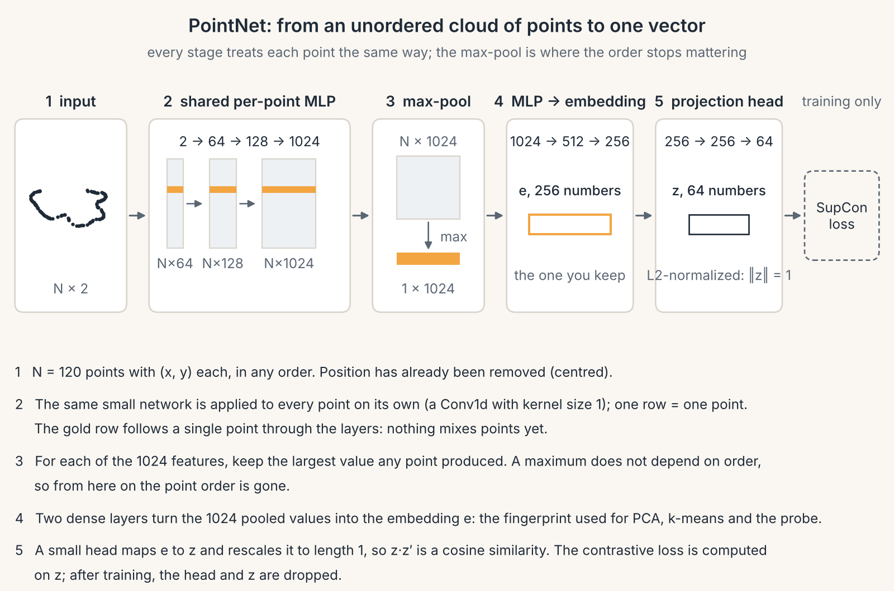
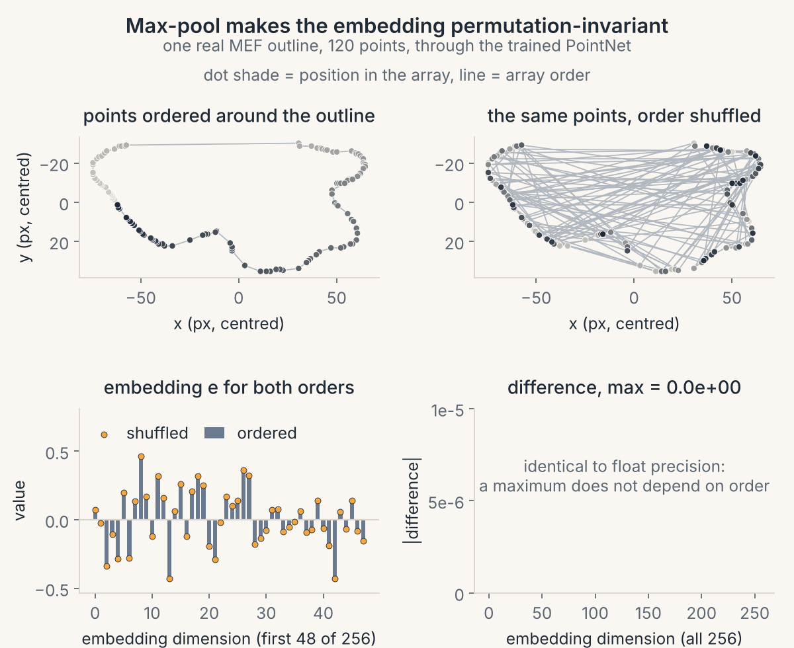
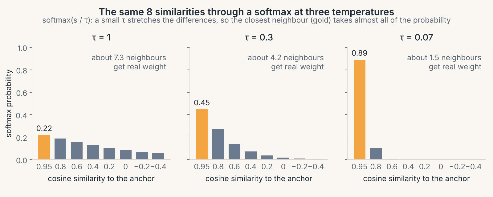
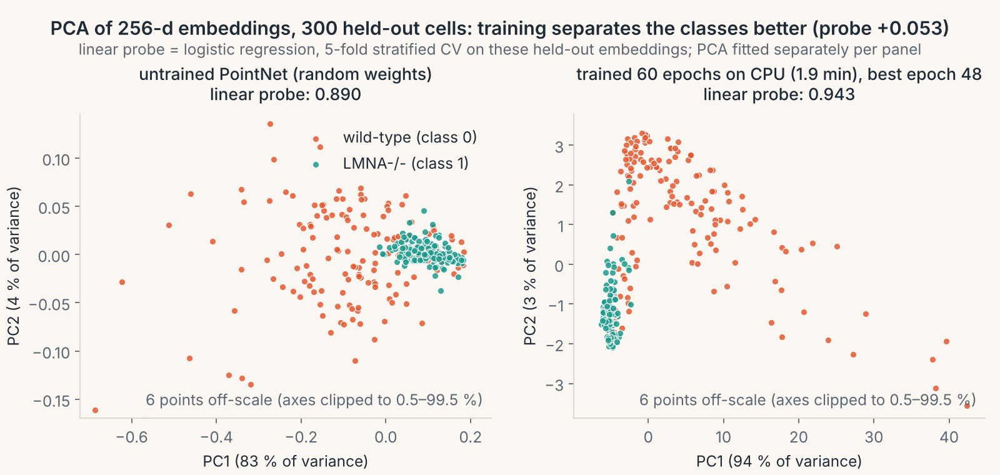

# 08 · Learned embeddings

> **In one breath.** When outlines are unordered point clouds with no matching landmarks, the Procrustes machinery has nothing to grip. PointNet asks every point the same questions and keeps only the most extreme answer to each, so the order of the points cannot matter; a supervised contrastive loss then pulls cells of the same type together and pushes the others apart on a unit sphere; and a plain logistic regression on the frozen embedding measures whether that worked. On the tutorial's one-epoch CPU run it had not yet.

## Point clouds versus landmarks

Every chapter so far relied on **correspondence**: landmark 3 of worm A matches landmark 3 of worm B, so $z^{H} w$ compares the right things. The MEF cells in `load_mef_subset()` do not have that. Each cell is 120 points picked at random from its outline, stored in random order. Point 3 of one cell is just some point on the membrane. Shuffle the rows and it is the same cell.

That rules out subtracting one cell from another, and so it rules out Chapters 03 to 06 as they stand. We need a function that takes a cloud of points and produces a fixed-length fingerprint, an **embedding**, with two properties: shuffling the points must not change it, and cells of the same type should get similar fingerprints. The first property is a matter of architecture; the second is learned.

The dataset here: 1200 cells, 120 points each, label 0 = wild-type (coral), 1 = LMNA−/− (teal). The tutorial used the full set of 5377 cells (2438 wild-type, 2939 lamin-deficient); the numbers quoted below are its saved results on that full set.

## PointNet: interview the crowd, keep the extremes

PointNet (Qi et al. 2017) does three things.

1. **Shared per-point MLP.** The same small network, a stack of "multiply by a matrix, add a bias, set negatives to zero" layers, is applied to every point *independently*. In the tutorial's version each $(x, y)$ point becomes 64 numbers, then 128, then 1024. Because the same weights are used for every point, the network cannot know which point is "first".
2. **Max-pool.** For each of the 1024 features, keep the largest value found over all 120 points. The result is 1024 numbers that describe the cell as a whole.
3. **A second MLP** on those 1024 numbers produces the embedding: 1024 → 1024 → 2048 in the tutorial.

The crowd picture: a cell is a crowd of 120 people. The per-point MLP is one interviewer asking each person the same 1024 questions. Max-pool records, for each question, the most extreme answer anyone gave. It does not matter in what order the people were interviewed; the sheet of 1024 extremes is identical.

$$
\mathbf{g} = \max_{j = 1 \dots N} \; f_{\theta}(\mathbf{p}_j), \qquad \mathbf{e} = h_{\phi}(\mathbf{g})
$$

Reading it:
- $\mathbf{p}_j$: point $j$ of the cloud, an $(x, y)$ pair; $N = 120$.
- $f_{\theta}$: the shared per-point network with weights $\theta$; it maps each point to 1024 features.
- $\max$: taken separately for each of the 1024 features, over all points. The max is the only step that mixes points, and it is blind to order.
- $\mathbf{g}$: the pooled 1024-vector; $h_{\phi}$: the second network; $\mathbf{e}$: the embedding (2048 numbers).
- Implemented by `shapekit.embed.PointNet(embed_dim, proj_dim)`.

**Worked example.** Three points $(1, 2)$, $(3, 0)$, $(0, 1)$ and two "questions": $q_1 = x + y$ and $q_2 = x - y$. The answers are $q_1 = 3, 3, 1$ and $q_2 = -1, 3, -1$. Max-pool: $(3, 3)$. Reorder the points as $(0, 1)$, $(1, 2)$, $(3, 0)$: the answers become $1, 3, 3$ and $-1, -1, 3$, and the maxima are still $(3, 3)$. Permutation invariance, by construction.


*The pipeline from 120 points to a 2048-number embedding and a 128-number normalized projection.*


*The same cell with its points shuffled gives the same embedding, bar for bar.*

The tutorial's network also has a "T-Net": a mini-network that looks at the whole cloud and proposes a $2 \times 2$ matrix (a rotation or stretch) to apply to all points first, initialized to "do nothing". It is PointNet's way of letting the network undo pose by itself, with no closed form. Chapter 09 explains that its original safety regularizer did not survive the port.

## Projection head and normalization

For training, the 2048-number embedding is passed through one more small network, the **projection head**, down to 128 numbers, and then rescaled to length 1:

$$
\mathbf{z} = \frac{\mathbf{u}}{\lVert \mathbf{u} \rVert}, \qquad \mathbf{z}_i \cdot \mathbf{z}_j = \cos\angle(\mathbf{u}_i, \mathbf{u}_j)
$$

- $\mathbf{u}$: the projection-head output (128 numbers); $\mathbf{z}$: the same vector shrunk or stretched to unit length.
- The dot product of two unit vectors is the cosine of the angle between them: $1$ for "pointing the same way", $0$ for unrelated, $-1$ for opposite. That is **cosine similarity**, and it is what the loss will see.
- The head is used only for the loss. After training it is discarded and the 2048-number embedding is what you keep; the tutorial's evaluation and plots all use the 2048 numbers.

## The supervised contrastive loss, one step at a time

Each training batch holds $B$ cells with labels. For one cell, the **anchor** $i$, the other cells of its class are **positives** $P(i)$, the rest are **negatives**. The loss of Khosla et al. (2020) is

$$
L_i = -\frac{1}{\lvert P(i)\rvert} \sum_{p \in P(i)} \log \frac{\exp(\mathbf{z}_i \cdot \mathbf{z}_p / \tau)}{\sum_{a \ne i} \exp(\mathbf{z}_i \cdot \mathbf{z}_a / \tau)}, \qquad L = \frac{1}{B}\sum_i L_i
$$

Reading it from the inside out:
- $\mathbf{z}_i \cdot \mathbf{z}_p$: how similar the anchor and a positive look, between $-1$ and $1$.
- $\tau$: the **temperature**, $0.07$ in the tutorial. Dividing by it multiplies every similarity by about 14 before anything else happens. It is a pickiness knob: small $\tau$ means a tiny difference in similarity becomes a huge difference in the next step.
- $\exp(\cdot) / \sum \exp(\cdot)$: a **softmax** over all other cells in the batch. It turns the similarities into a probability distribution answering "of all the other cells, how likely is it that $p$ is my neighbor?"
- $-\log$: turns a probability into a penalty: $0$ when the probability is $1$, large when it is small.
- The penalty is averaged over the anchor's positives, then over all anchors.
- Implemented by `shapekit.embed.SupConLoss(temperature)`. In practice the row maximum is subtracted before `exp` to avoid overflow; it cancels out.

**Worked example 1: the pickiness knob.** An anchor sees two other cells with similarities $0.9$ and $0.1$. The softmax probability of the first is $1 / (1 + e^{-0.8/\tau})$.
At $\tau = 1$: $1/(1 + e^{-0.8}) = 1/1.449 = 0.690$, so the two get 69% and 31%.
At $\tau = 0.3$: $1/(1 + e^{-2.667}) = 1/1.070 = 0.935$.
At $\tau = 0.07$: $1/(1 + e^{-11.43}) = 0.99999$. The same two numbers, read as "mildly prefer the first" or as "the first is the only one that counts", depending on $\tau$.


*The same similarities, turned into probabilities at three temperatures.*

<div class="demo" data-demo="contrastive"></div>

**Worked example 2: a batch of four.** Cells A and B are wild-type, C and D are LMNA−/−. Anchor A has one positive, B, and three "others", B, C, D. If all four vectors are identical, every $\exp$ term is equal, the softmax gives B a probability of $1/3$, and $L_A = -\log(1/3) = \ln 3 = 1.099$. The same holds for every anchor, so $L = \ln 3$. Now let A·B $= 0.9$ and A·C $=$ A·D $= 0.1$ at $\tau = 0.3$: the logits are $3, 0.333, 0.333$, the exponentials $20.09, 1.40, 1.40$, the probability of B is $20.09/22.88 = 0.878$, and $L_A = -\ln 0.878 = 0.130$. The anchor is rewarded for sitting near its positive and away from its negatives.

**The "learned nothing" benchmark.** With a batch of 200, each anchor sees 199 others. If the embedding carries no information they are all equally similar, so each positive gets probability $1/199$ and the loss is $\ln 199 \approx 5.29$. Keep that number in mind.

One trap: if an anchor has no positive in the batch, $\lvert P(i)\rvert = 0$ and the loss is $0/0$, which is NaN. Batches must be large or stratified enough that every class appears at least twice.

## Measuring the embedding: the linear probe

Training loss tells you how the projection behaves on training batches. To ask whether the 2048-number embedding is *useful*, the tutorial freezes the network, computes embeddings for held-out cells, and fits a **logistic regression** on them:

$$
P(\text{LMNA}^{-/-} \mid \mathbf{e}) = \sigma\!\left(\mathbf{w}\cdot\mathbf{e} + b\right), \qquad \sigma(x) = \frac{1}{1 + e^{-x}}
$$

- $\mathbf{w}, b$: 2048 weights and one bias, learned by the probe; $\sigma$: the S-curve that squashes any number into a probability.
- A straight-line rule is deliberately weak. If it separates the classes, the embedding has already organized them.
- Accuracy is estimated by **stratified 5-fold cross-validation**: cut the cells into five parts with the same class ratio in each, train on four, test on the fifth, rotate, average.
- Implemented by `shapekit.embed.linear_probe_accuracy(features, labels)`.

Finally, with embeddings in hand you can reuse Chapter 06's tools: PCA to two dimensions for a scatter plot colored by class, and k-means with two clusters to see whether an unsupervised split lines up with the labels. The tutorial's k-means figure plotted raw embedding dimensions 0 and 1 rather than the PCA axes and reported no score; use the PCA axes and report agreement with the labels.


*First two principal components of the 256-number embeddings of 300 held-out cells, before and after a 60-epoch CPU run of `scripts/make_figures_embed.py` (about 2 minutes). Linear-probe accuracy on those held-out cells: 0.89 untrained, 0.94 trained (5-fold CV, seed 0). The untrained baseline is higher than the tutorial's 0.835 because these cells are centered over the correct axis and the probe standardizes its features [Inference]. The gain is real but modest; the validation contrastive loss barely drops below its "learned nothing" level of ln 63 ≈ 4.14, so the projection head generalizes less than the embedding does.*

## What the one-epoch results actually showed

Results on the tutorial's saved runs (CPU, full MEF set, batch 200, $\tau = 0.07$, one epoch):

| | Exercise run | Solution run |
|---|---|---|
| Probe accuracy, untrained random weights | 0.835 | 0.835 |
| Training loss after 1 epoch | 5.269 | 5.276 |
| Probe accuracy after 1 epoch | 0.741 | 0.822 |

Three readings, all [Inference]:
- A loss of 5.27 sits on top of the "learned nothing" level of $\ln 199 \approx 5.29$. One epoch had barely moved the weights.
- Accuracy after training is *lower* than before. The random network already gives a linearly separable embedding at 0.835, which says more about the data (a random projection of 120 outline points keeps a lot of geometry) than about learning.
- The two runs differ because the train/validation split was not seeded; the probe was measuring different cells each time.

So the saved notebook demonstrates the plumbing, not a trained model; the exercise asks the student to raise the epoch count. Chapter 09 lists the bugs that would also have held a longer run back.

## Try it

```python
import numpy as np, torch
from shapekit.datasets import load_mef_subset
from shapekit.embed import PointNet, SupConLoss, linear_probe_accuracy

points, labels, keys = load_mef_subset()           # (1200, 120, 2), (1200,), keys
X = torch.tensor(points - points.mean(axis=1, keepdims=True))   # center each cell (N, 2 convention)
batch = np.random.default_rng(0).choice(len(X), 200, replace=False)   # a mixed batch of both classes
torch.manual_seed(0)
net = PointNet(embed_dim=256, proj_dim=64)          # untrained: random weights
loss_fn = SupConLoss(temperature=0.07)
net.eval()
with torch.no_grad():
    proj, emb = net(X[batch])                       # (normalized projection, embedding)
print(loss_fn(proj, torch.tensor(labels[batch])))   # expect close to ln(199) = 5.29
print(linear_probe_accuracy(emb.numpy(), labels[batch]))   # already well above 0.5, untrained
shuffled = X[0][torch.randperm(120)]
with torch.no_grad():
    print(torch.allclose(net(X[:1])[1], net(shuffled[None])[1], atol=1e-5))  # True: order does not matter
```

## Check yourself

<details><summary>1. Why can the per-point MLP not tell which point came first, and why does max-pool not care?</summary>
The MLP is applied to each point separately with the same weights, so it never sees two points together. Max-pool takes, per feature, the largest value over all points, and the largest value of a set does not depend on the order in which you list the set.
</details>

<details><summary>2. A batch of 50 cells with identical, information-free projections. What is the loss?</summary>
Each anchor sees 49 others, all equally similar, so each positive has probability $1/49$ and the loss is $\ln 49 \approx 3.89$.
</details>

<details><summary>3. The probe reports 0.90 accuracy on the training cells. Is the embedding good?</summary>
Unknown. The probe must be evaluated on cells the network never saw, with a seeded stratified split, and compared with the untrained baseline (0.835 in the tutorial). Beating the baseline on held-out cells is the claim; a training-set number is not.
</details>

## Credits

Adapted from notebook 3 (*Shape Embeddings*) and the `shape_embeddings/` package of *Shape Analysis 101* by Johannes Hugger and Virginie Uhlmann (Uhlmann group, EMBL-EBI, 2021; BSD-3), written by Johannes Hugger, which build on PointNet (Qi, Su, Mo & Guibas 2017; reference code fxia22/pointnet.pytorch, MIT) and supervised contrastive learning (Khosla et al. 2020; reference code HobbitLong/SupContrast, BSD-2). `shapekit.embed` re-implements both; the training results quoted are from this repository's own run.

**Next:** [09 · Field notes: bugs and how to avoid them](09-field-notes.md)
