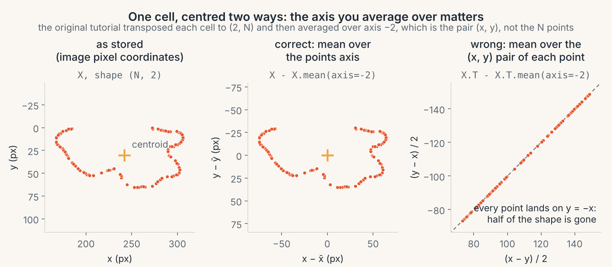

# 09 · Field notes: bugs and how to avoid them

> **In one breath.** The tutorial this guide adapts is good teaching material with a handful of real bugs, and every one of them is a bug you will write yourself one day. This chapter tells each as a short story: what you would have seen, what the cause was, why nobody caught it, and the habit that catches it. The habits are the point; the bugs are the examples.

A note on evidence. The *causes* below were established by reading the original repository's code and git history, and by comparing it with the upstream projects it borrowed from. The *motives* (why a reasonable person did it) are marked **[Inference]**. One background fact frames all of it: the embedding code was written in about four weeks before a June 2021 course and never maintained afterwards. That is not a criticism. It is the normal life of research code, and the reason these habits earn their keep.

## 1. The centering that subtracted the wrong thing

**Symptom.** Cells reached the network not centered. Worse, each point $(r, c)$ had become $((r - c)/2,\ (c - r)/2)$: one number stored twice with opposite signs. Half of every point's position was gone before learning started.

**Worked example.** Three points $(100, 300)$, $(120, 310)$, $(90, 250)$. Correct centering subtracts the centroid $(103.3, 286.7)$ and gives $(-3.3, 13.3)$, $(16.7, 23.3)$, $(-13.3, -36.7)$. The bug subtracted each *point's own* mean: $(100 + 300)/2 = 200$, so $(100, 300) \to (-100, 100)$; likewise $(120, 310) \to (-95, 95)$ and $(90, 250) \to (-80, 80)$. Every output lies on the line $y = -x$.


*One cell centered correctly (left) and with the mean taken over the wrong axis (right): the outline collapses onto a diagonal.*

**Cause.** `Center` was copied from PyTorch Geometric, where a cloud is stored points × 2 and "mean over axis −2" means "average over the points". PointNet, copied from `fxia22/pointnet.pytorch`, stores clouds as 2 × points, and the data loader transposed each cell to match it. `Center` then ran on a $(2, 120)$ array and averaged over the axis of length 2. Two correct conventions met in one pipeline, and neither function said which it expected.

**Why nobody noticed.** The code did not crash; a $(2, 120)$ array minus a $(1, 120)$ array is perfectly legal. [Inference] And the downstream number looked fine: an untrained network still reached 0.835 probe accuracy, because a diagonal projection of an outline still carries shape information. Nothing was obviously wrong, so nobody looked.

**Habit.** Write the axis convention at the top of every module and in every docstring (`shapekit` uses points-as-rows, `(N, 2)`, everywhere and says so in `shapekit/__init__.py`). Then make the code refuse the other one: `assert X.shape[-1] == 2` at the entry of every function that takes a shape. A one-line assert would have turned a silent corruption into a loud error on the first run.

## 2. The model that never went back to training

**Symptom.** BatchNorm used frozen running statistics during all training, so the network was being trained in a mode it was never meant to learn in. [Inference] Training would still move, just worse and less stably than intended.

**Cause.** Both upstream training scripts, `pointnet.pytorch` and `SupContrast`, call `model.train()` at the start of each epoch. When the loop was split into a `train_loop` function and a `validation_loop` function, `validation_loop` kept its `model.eval()` and the matching `model.train()` was lost. After the first validation pass the model stayed in eval mode forever.

**Why nobody noticed.** `eval()` and `train()` change no shapes and raise no errors; they change what BatchNorm and dropout do. The one-epoch runs in the saved notebooks were too short to show a difference.

**Habit.** Treat `model.train()` and `model.eval()` as a pair, like opening and closing a file. The first line of a training function is `model.train()`; the first line of an evaluation function is `model.eval()` inside `torch.no_grad()`. Never rely on the mode a previous function left behind.

## 3. The "best model" that was a live pointer

**Symptom.** `best_params = model.state_dict()` was meant to snapshot the best epoch. It stored references to the live weight tensors, so "best" silently tracked "latest". The untrained baseline, which scored highest, was also never a candidate.

**Why nobody noticed.** The variable had the right name and the right type. With one epoch, best and latest are the same thing.

**Habit.** `best_params = copy.deepcopy(model.state_dict())`, always. And evaluate epoch 0 before the loop, so the baseline competes.

## 4. The transformer that lost its seat belt

**Cause.** PointNet's `STN3d` was renamed `SpatialTransformer3d`, given 2 input channels for 2-D points, and kept its "3d" name. The original paper's regularizer, which penalizes the predicted transform for drifting away from an orthogonal matrix, was not ported. [Inference] Without it, the T-Net is free to squash or stretch the cloud arbitrarily, which gives the loss an easy but useless way to move.

**Habit.** When you port a component, port its constraints too, and list what you dropped in the docstring. A renamed function with a misleading name ("3d") is a sign that the port was partial.

## 5. Code that was never called

**Symptom.** `RandomCoordsFlip` would crash (`random` not imported). `segmentation_to_pointcloud` used `napari` without importing it and opened a viewer per cell. `fullDistance` and `partialDistance` called a method without `self.`. An error path raised `SplineCurve.noCoefsMessage` where no `SplineCurve` existed. In `main.py`, `run_loss += run_loss` kept the validation loss at exactly 0. The loader's `transforms` argument was accepted and ignored.

**Why nobody noticed.** None of these lines ran during the course. The notebook overrode the loader with its own copy, augmentation was never switched on, and the error path needs a misuse to trigger. Dead code does not fail; it waits.

**Habit.** A test that merely *calls* every public function once, on a tiny input, catches every item on that list. It needs no clever assertions. `shapekit`'s `tests/` are built on this principle and are meant to run in under a minute.

## 6. The split that changed every run

**Symptom.** Two runs of the same notebook reported 0.741 and 0.822 validation accuracy after one epoch, with nothing changed. The points in `mef_data.npy` were also picked at random from each outline without a seed, so the dataset itself cannot be regenerated exactly.

**Cause.** The loader shuffled cells with no fixed seed before cutting 75/25. The cross-validation folds were not shuffled at all.

**Habit.** Seed every split and every random pick, pass the seed as an argument, and print it. `shapekit.procrustes.gpa_mean(Z, seed=0)` and `TangentPCA.sample(n, n_modes, seed)` take one for the same reason. A result that cannot be reproduced cannot be compared.

## 7. Dependencies that moved under the code

**Symptom.** On a current install, `np.complex` is gone (NumPy 1.24), `np.Inf` is gone (NumPy 2.0), and `skimage.morphology.skeletonize_3d` no longer imports. `tifffile`, `imageio` and `napari` were used but never listed.

**Cause.** All three names were valid in 2021 and removed later. scikit-image and others were unpinned, so a fresh install got whatever was newest.

**Habit.** Pin versions (the guide's `requirements.txt` is meant to), list every import, and prefer the names a library documents as stable. When you must use something deprecated, leave a comment with the date.

## 8. Comments that outlived their code

Three stories with one moral.

- A solution notebook says the GPA result "is completely different from the Fréchet mean". The comment was written in June 2021 for a *one-pass* alignment, which does differ. In December 2021 the loop was rewritten to iterate to convergence, which makes it power iteration on the same matrix (Chapter 05). Re-computation from six random starts converges to within $10^{-5}$ of the Fréchet mean. The comment stayed.
- The spline notebook says a worm is described by "6 complex numbers". The code uses $M + 4 = 10$ (Chapter 07).
- The chord-distance formula in the notebook was wrong until December 2022. The "Procrustes equals chord to 15 digits" result in Chapter 04 holds for the corrected formula; a reader of an older checkout would have seen a disagreement and been told nothing.

**Habit.** Read every comment that states a result as a *claim to re-verify*, not as a fact. When you change a loop, grep for prose that describes what the loop used to do. Better still, put the claim in a test: `assert geodesic_distance(gpa_mean(Z), frechet_mean(Z)) < 1e-4` cannot go stale silently.

## 9. One factor of $\sqrt{n-1}$

The synthetic-worm cell multiplied each mode's random coefficient by $\sqrt{\lambda (n-1)}$, a singular value, instead of $\sqrt{\lambda}$, a standard deviation, making every sample about 28 times too far from the mean (Chapter 06). [Inference] It was never fixed because the exercise's question, "How good do you think this model is?", made a bad-looking plot seem like the intended lesson. **Habit:** when generating from a fitted model, compare the generated quantities (here, tangent-vector lengths) with the same quantities measured from real data before looking at pictures.

## The habits, collected

1. State the axis convention at the top of every module; assert shapes at every entry point.
2. `model.train()` and `model.eval()` come in pairs; set the mode at the top of each function.
3. Snapshot with `copy.deepcopy(state_dict())`; evaluate the baseline as a candidate.
4. Port constraints along with components; name things for what they are.
5. Keep a test that calls every public function.
6. Seed every split and every random pick; print the seed.
7. Pin dependencies; list every import.
8. Treat comments that state results as claims; turn the important ones into tests.
9. Sanity-check generated data against real data in the same units.

None of this is specific to shape analysis. All of it would have made the tutorial's one-epoch run tell the truth.

## Try it

```python
import copy, numpy as np
from shapekit.datasets import load_mef_subset
from shapekit.preshape import center

points, labels, keys = load_mef_subset()
cell = points[0]                                   # (120, 2): points are rows
assert cell.shape[-1] == 2, "expected (N, 2)"      # habit 1
good = center(cell)
bad = cell - cell.mean(axis=1, keepdims=True)      # the tutorial's mistake, reproduced on purpose
print(np.allclose(good.mean(axis=0), 0))           # True
print(np.allclose(bad[:, 0], -bad[:, 1]))          # True: every point collapsed onto y = -x
state = {"w": np.zeros(3)}
snapshot, alias = copy.deepcopy(state), state      # habit 3
state["w"][:] = 1
print(snapshot["w"], alias["w"])                   # [0 0 0] [1 1 1]
```

## Check yourself

<details><summary>1. A function subtracts a mean and the result has the right shape. Why is that not proof it is correct?</summary>
Broadcasting makes many wrong axis choices legal. A $(2, N)$ array minus a $(1, N)$ array works, and so does minus a $(2, 1)$ array; only one of them centers the cloud. Check the result (the centroid should be zero), not the shape.
</details>

<details><summary>2. Your validation loss is exactly 0.0 every epoch. What do you suspect first?</summary>
An accumulator bug such as <code>run_loss += run_loss</code> (0 plus 0 stays 0), or an evaluation function that never calls the loss. A loss of exactly zero on real data is too good to be true.
</details>

<details><summary>3. A comment in a notebook says two methods give different answers. What do you do before believing it?</summary>
Re-run both and compare numerically, and check whether the code under the comment has changed since the comment was written. Comments describe the code at the moment they were typed.
</details>

**Next:** [Glossary](glossary.md) · [Cheat sheet](cheatsheet.md) · [References](references.md)
